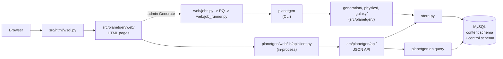
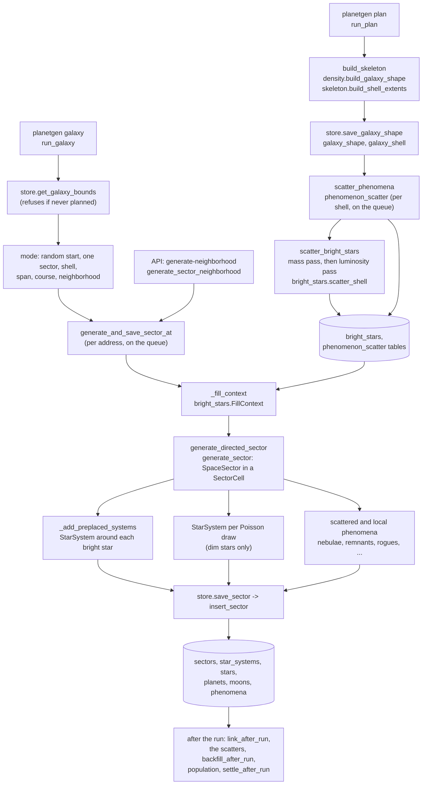
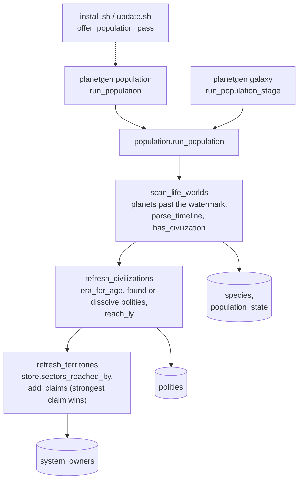
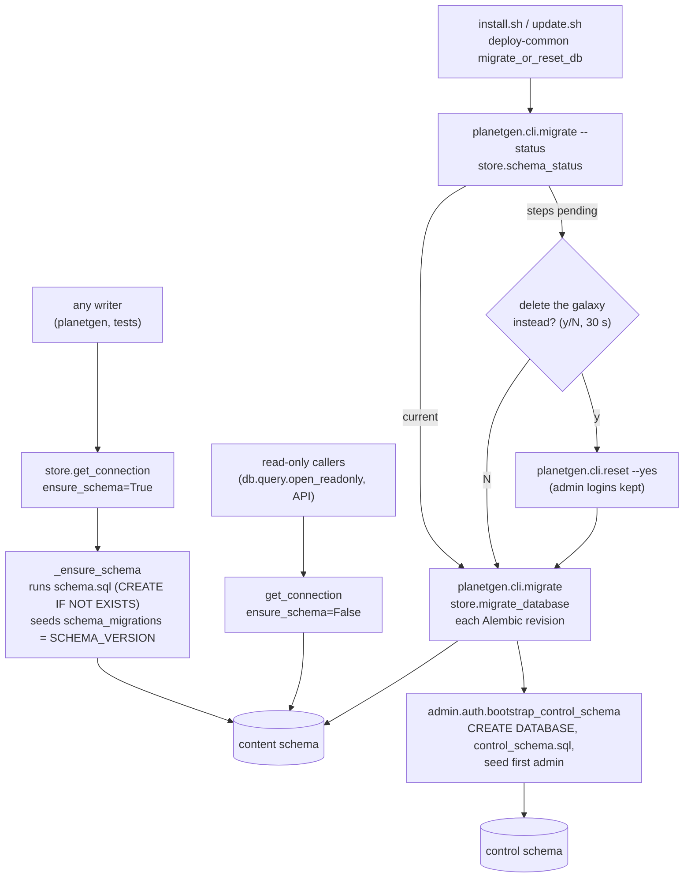
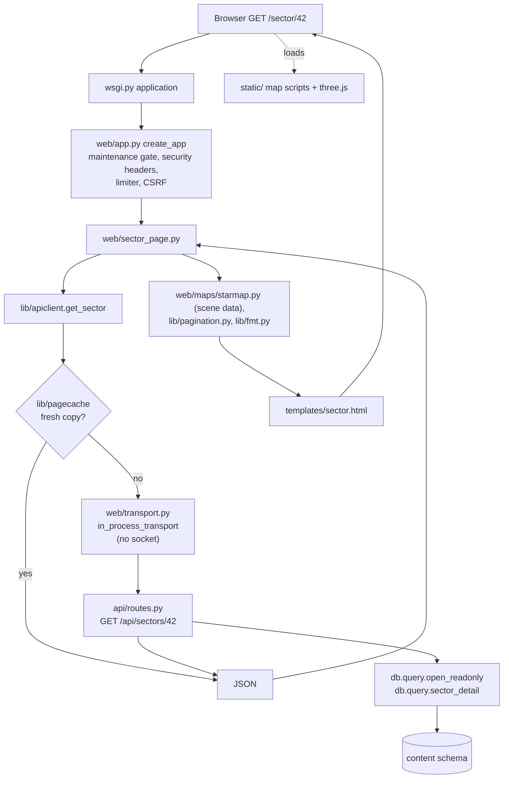
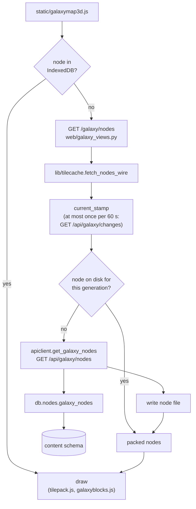
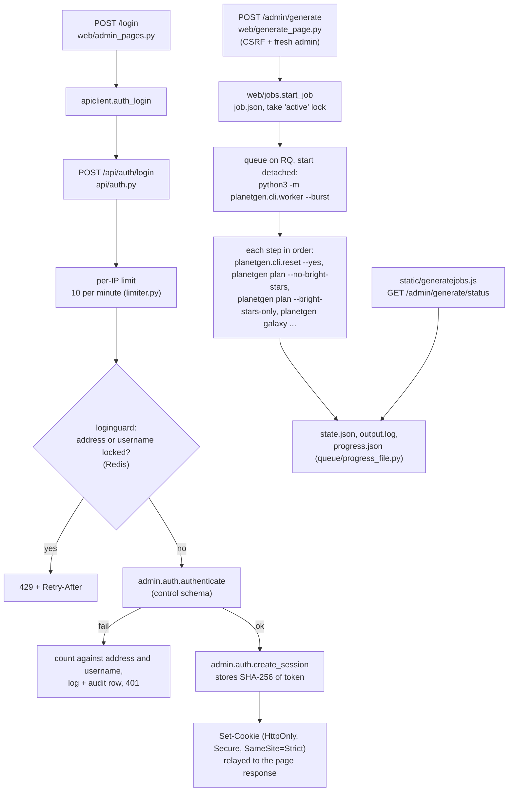
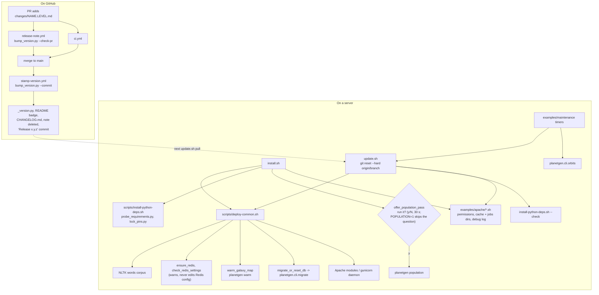

# Architecture: how planetGen fits together

This document is the map of the program. It says which file holds what,
and it traces the main flows (generating a galaxy, storing it, serving it,
running admin jobs, shipping a release) through those files. Use it to
find where something lives before you open the code.

It does not repeat the reference docs. For details, follow the links:
[api.md](../../reference/api.md) (the JSON API), [database-schema.md](../../reference/database-schema.md)
(tables and columns), [html-interface.md](../../reference/html-interface.md) (the web
pages), [config.md](../../reference/config.md) (`config.json`), [testing.md](../../reference/testing.md)
(the test suite) and [deployment/](../../deployment/README.md) (servers).
The other files in this folder are topic designs; they explain why a part
works the way it does.

**Keeping it current.** A PR that adds, moves, renames or removes a module,
script, workflow or top-level folder updates this file in the same PR. If a
flow below changes shape (a new step, a new cache, a new process), update
its diagram too. Each module's own docstring stays the detailed source of
truth; this file only needs one line per module.

## Contents

- [The big picture](#the-big-picture)
- [Map of the repository](#map-of-the-repository)
  - [Top level](#top-level)
  - [scripts/](#scripts)
  - [examples/](#examples)
  - [src/planetgen/](#srcplanetgen)
  - [src/html/](#srchtml)
  - [src/tests/](#srctests)
  - [.github/workflows/ and changes/](#githubworkflows-and-changes)
- [Flow 1: generating a galaxy](#flow-1-generating-a-galaxy)
- [Flow 2: storing and migrating the database](#flow-2-storing-and-migrating-the-database)
- [Flow 3: serving a page and a map](#flow-3-serving-a-page-and-a-map)
- [Flow 4: admin login and background Generate jobs](#flow-4-admin-login-and-background-generate-jobs)
- [Flow 5: install, update and releases](#flow-5-install-update-and-releases)

## The big picture

planetGen has three layers that share one Python package:

1. **Generation.** `planetgen` and the `generation/`, `physics/`, `galaxy/`,
   `population/`, `names/` and `describe/` packages under `src/planetgen/`
   build stars, planets, sectors and whole galaxies from physics models
   and random draws.
2. **Storage.** `src/planetgen/db/store.py` writes those objects into a
   MySQL database (`schema.sql`), reads them back, and migrates old
   databases forward. A second, separate schema (`control_schema.sql`)
   holds admin logins.
3. **Serving.** One Flask app (`planetgen/web/app.py`, started by `src/html/wsgi.py`) serves both the JSON API
   (`/api/...`) and the HTML pages. The pages never query the database
   themselves; they call the API in-process through `planetgen/web/lib/apiclient.py`,
   and the API reads through `planetgen.db.query` and `store.py`. Redis sits beside
   MySQL: the work queue (RQ), the rate limits, the login throttle and a running job's
   progress live there (see [redis-and-the-work-queue.md](../operations/redis-and-the-work-queue.md)).

Around those sit the installers (`install.sh` and `update.sh`), maintenance tools (`planetgen.cli.orbits`,
`planetgen.cli.migrate`, ...), the tests, and the release workflows.

## Map of the repository

### Top level

| Path | What it holds |
|---|---|
| [`planetgen`](../../../src/planetgen/cli/generate.py) | The single generation CLI, with six subcommands: `system`, `sector`, `galaxy`, `plan`, `phenomenon` and `population` (the population and politics pass over what is stored). `galaxy` also runs that pass as one of its stages; `sector` and `phenomenon` only generate (PERF.124). Also the library functions other code calls: `generate_sector`, `generate_sector_neighborhood`, `build_skeleton`, `scatter_bright_stars`. Installed as the `planetgen` console script (`setup.py`). |
| [`install.sh`](../../../install.sh) | One-shot installer for Linux (Apache with mod_wsgi) and macOS (gunicorn under launchd, nginx in front): Python libraries, NLTK corpus, `planetgen.cli.migrate`, the optional population pass prompt, Apache modules or the gunicorn daemon, permissions, tile cache and jobs directories, debug log. |
| [`update.sh`](../../../update.sh) | `git reset --hard` to the branch tip, then the same checks as `install.sh`, changing only what is missing, but never the population pass (run `planetgen population` by hand). Safe to run on a schedule. |
| `setup.py`, `pyproject.toml` | The Python package (`planetgen`, from `src/`) and its dependency floors and extras (`api`, `test`, `browser`). |
| `INSTALL.md`, `config.schema.json` | The installation guide, and the JSON schema `config.json` is checked against. |
| `requirements.lock`, `requirements-server.lock` | Hash-pinned dependency locks, written by `scripts/lock-requirements.sh`. |
| `config.json.example` | Template for the per-deployment `config.json` (gitignored). See [config.md](../../reference/config.md). |
| `pytest.ini` | Puts `src` on the path for the tests, sets the 15-minute per-test timeout and declares the markers (`db`, `slow`, `browser`, `generation`, `heavy`, `area_*`, ...). |
| `CHANGELOG.md`, `README.md` | Release history and the project front page. Both are stamped by the release flow, never edited for the version by hand. |
| `changes/` | Pending release notes, one file per PR. See [Flow 5](#flow-5-install-update-and-releases). |
| `docs/` | Reference docs, `design/` topic designs, `analysis/` reviews, `deployment/` server guides, `TODO.md` (open work) and `plan/` (one plan per phase of it). |

### scripts/

| Path | What it holds |
|---|---|
| [`scripts/deploy-common.sh`](../../../scripts/deploy-common.sh) | Steps shared by `install.sh` and `update.sh` (sourced by both; `offer_population_pass` is the installer's alone): pick the Python, NLTK corpus, Apache modules or gunicorn launchd daemon, mod_wsgi check, import check, and `migrate_or_reset_db` (the y/N "delete the galaxy instead?" prompt), and `offer_population_pass` (the y/N "run the population pass now?" prompt, default No after 30 seconds, skipped with no terminal; `POPULATION=1` runs it without asking). |
| [`scripts/install-python-deps.sh`](../../../scripts/install-python-deps.sh) | Makes the libraries importable by the system Python: plain pip, or apt first on an externally managed (PEP 668) Python, or a venv on macOS. `--check` installs only what is missing or too old. |
| `scripts/probe_requirements.py` | Reports each requirement as ok, missing, old or broken. Used by `install.sh` and `update.sh`. Standard library only. |
| `scripts/lock_pins.py` | Reads `requirements.lock` for `install-python-deps.sh` (constraints, resolve). Standard library only. |
| [`scripts/test.py`](../../../scripts/test.py) | Picks and runs a slice of the test suite (`changed`, `quick`, `full --check`, `budget`, ...; TEST.139). See [testing.md](../../reference/testing.md). |
| `scripts/generate_db_models.py` | Writes `planetgen/db/models.py` (SQLAlchemy `Table` declarations) from `schema.sql` (DB.11). |
| `scripts/check_redis_settings.py` | Warns about Redis server settings that do not suit planetGen (OPS.48); run by `install.sh` and `update.sh`. |
| [`scripts/build_architecture_map.py`](../../../scripts/build_architecture_map.py) | Writes `docs/generated/architecture-map.html`, the code map that drills down from the project's areas to a function's source with the calls between them (DOC.67); `--check` fails when a module of the package is missing from the page. Its page shell is `scripts/architecture_map/template.html`. |
| [`scripts/build_reference_pages.py`](../../../scripts/build_reference_pages.py) | Writes, or with `--check` checks, the data of the References pages (`docs/references/overview.json`) from the reference list and the stand-in registry; `update.sh` runs it in step 3 (DOC.88). |
| `scripts/build_unit_ladders.py` | Writes the browser's copy of the unit ladders (`static/unitladders.js`) from `planetgen/util/ladders.py` (UX.23). |
| `scripts/build_unit_registry.py` | Writes the browser's copy of the unit registry (`static/unitregistry.js`: every unit, its kind, factor and offset, and `convert`) from `planetgen/physics/unit_registry.py` (UX.140). |
| `scripts/vendor_shoelace.py` | Copies the parts of Shoelace the site uses into `static/vendor/shoelace/`. |
| `scripts/build_todo_docs.py`, `scripts/todo_docs/` | Builds the three browsable TODO pages from the TODO sources. |
| [`scripts/build_global_docs.py`](../../../scripts/build_global_docs.py) | Rebuilds, or with `--check` checks, every global document in order (the architecture map, the plan pages, the docs index); only the TODO thread runs it, and the tests that compare them with their sources are the `globaldocs` tests, skipped unless `PLANETGEN_GLOBAL_DOCS=1` (DOC.69). |
| `scripts/bench_nav.py`, `scripts/star_type_by_radius.py` | Developer tools: times `nav_between` on a large synthetic galaxy (NAV.10); star types against distance from the core (GEN.133). |
| `scripts/lock-requirements.sh` | Rewrites `requirements.lock` with `uv`. Run by a developer after changing a requirement, never on a server. |
| [`scripts/bump_version.py`](../../../scripts/bump_version.py) | Turns `changes/` notes into releases: bumps `_version.py`, the README badge and `CHANGELOG.md` together. Also the PR check (`--check-pr`). |

### examples/

Copy-and-edit configuration for each kind of server. The guides in
[deployment/](../../deployment/README.md) say which files to use.

| Path | What it holds |
|---|---|
| `examples/apache/` | The Apache vhost (`planetgen.conf.example`) and the helpers `install.sh`/`update.sh` call: `set-permissions.sh`, `create-cache-dir.sh` (tile cache and jobs directories, via `deploy-paths.py`), `setup-debug-log.sh`, `apache-identity.sh`. |
| `examples/redis/` | The Redis settings planetGen needs (AOF every second, no eviction); `update.sh` only warns, it never edits the server's own config. |
| `examples/fail2ban/` | A fail2ban filter and jail for repeated failed logins. |
| `examples/nginx/`, `examples/caddy/` | Reverse-proxy configs for gunicorn behind nginx or Caddy. |
| `examples/macos/` | launchd plists (gunicorn, orbit update, update) and the Homebrew nginx config. |
| `examples/systemd/` | The gunicorn service and a drop-in that reloads the web server after an update. |
| `examples/maintenance/` | Scheduled maintenance: systemd timers and units for `planetgen.cli.orbits` (per database) and `update.sh`, `install-maintenance-timer.sh` (also makes launchd daemons on macOS). |
| `examples/systems/` | Sample system files for `planetgen system --system-file` (Solar System, Tatooine, ...). See [example-systems.md](../../reference/example-systems.md) and [system-file-format.md](../../reference/system-file-format.md). Checked by `test_examples.py`. |

### src/planetgen/

The package. Generation, physics, the galaxy, storage, the API and the pages all live under it; the groups below follow its folders.

#### Package root

The package root. The groups below are by role.

| Path | What it holds |
|---|---|
| [`_version.py`](../../../src/planetgen/_version.py) | The package version, stamped by the release workflow (never edited by hand). |
| [`tuning.py`](../../../src/planetgen/tuning.py) | Constants specific to this program's design, not physical fact: generation-tuning knobs and probabilities. |

#### src/planetgen/generation/

Building the objects a run creates, and the commands that run it. Generation code works in natural units and knows nothing about the database; `db/store.py` is the one place that converts and stores.

| Path | What it holds |
|---|---|
| [`__init__.py`](../../../src/planetgen/generation/__init__.py) | Generation: building the objects a run creates, and the commands that run it. |
| [`belt.py`](../../../src/planetgen/generation/belt.py) | `AsteroidBelt`: an asteroid belt within a star system and its composition. |
| [`binary.py`](../../../src/planetgen/generation/binary.py) | `BinaryStarProxy`: a close (P-type) binary treated as one central star for planet generation. |
| [`bright_stars.py`](../../../src/planetgen/generation/bright_stars.py) | Bright-star pre-placement: every star at least `tuning.BRIGHT_STAR_MIN_LUMINOSITY_SOL` bright is drawn and placed galaxy-wide right after `planetgen plan`, into `bright_stars`, while every sector stays unfilled. |
| [`comet.py`](../../../src/planetgen/generation/comet.py) | `Comet`: a star-bound comet on a real Kepler or Barker orbit. |
| [`config.py`](../../../src/planetgen/generation/config.py) | `SystemConfig`: every generation option for a system (mostly tri-state flags), from the CLI or a system file. |
| [`directives.py`](../../../src/planetgen/generation/directives.py) | Generation directives for a sector (GEN.96): minimums a run asks of a sector, such as "at least 5 systems", "at least 2 habitable worlds" or "at least 3 G-type stars". |
| [`evolution.py`](../../../src/planetgen/generation/evolution.py) | The speculative evolutionary timeline for a habitable planet, from its host star's spectral class. |
| [`life.py`](../../../src/planetgen/generation/life.py) | Whether and how life arises on a planet or moon: biochemistry, evolution speed and timeline. |
| [`limits.py`](../../../src/planetgen/generation/limits.py) | Upper bounds on the generation inputs an admin can type, checked by the Generate pages, the API and `planetgen`'s own argument parsing alike. |
| [`luminosity_floor.py`](../../../src/planetgen/generation/luminosity_floor.py) | The luminosity floor presets (GEN.184): the brightness above which every star is scattered galaxy-wide. |
| [`object_first.py`](../../../src/planetgen/generation/object_first.py) | The object-first scatter (PERF.58): decide how many objects a shell holds, then where, instead of walking every band of every shell. |
| [`object_timing.py`](../../../src/planetgen/generation/object_timing.py) | How long each generated object takes, per object and per object type (PERF.92), on top of the per-stage and per-job records (PERF.67). |
| [`phenomena_plausibility.py`](../../../src/planetgen/generation/phenomena_plausibility.py) | The exotic-phenomena plausibility anomaly finder (a developer report). |
| [`phenomenon_scatter.py`](../../../src/planetgen/generation/phenomenon_scatter.py) | Phenomenon pre-placement (GEN.100): the black holes, neutron stars, planetary nebulae and supernova remnants of the whole galaxy, its hypervelocity stars and the nucleus, drawn and placed right after `planetgen plan`. |
| [`planet.py`](../../../src/planetgen/generation/planet.py) | `Planet`: one planet or moon, its state and its description text. |
| [`plausibility.py`](../../../src/planetgen/generation/plausibility.py) | The physical-plausibility anomaly finder (a developer report, not part of a run). |
| [`prevalence.py`](../../../src/planetgen/generation/prevalence.py) | Prevalence: how much more or less often a sector or galaxy run's systems get a feature than they would by chance (GEN.52). |
| [`run_common.py`](../../../src/planetgen/generation/run_common.py) | What every generation command shares: the console progress bar, the `--strict` refuse-or-warn rule, the run's counts, the work queue a run hands its sectors to, and the statistics and estimate a bulk run checks first. |
| [`run_galaxy.py`](../../../src/planetgen/generation/run_galaxy.py) | The `galaxy` command: many sectors placed as one galaxy, each at its shell/band/wedge address in the spherical grid, with its systems inside the sector's own cell. |
| [`run_phenomenon.py`](../../../src/planetgen/generation/run_phenomenon.py) | The `phenomenon` command: one exotic stellar phenomenon (a black hole, neutron star, nebula, supernova remnant, rogue planet, interstellar comet or asteroid field), on demand. |
| [`run_plan.py`](../../../src/planetgen/generation/run_plan.py) | The `plan` command: the galaxy's density skeleton (`galaxy_shape`, `galaxy_shell`) that a run consults, and the galaxy-wide star and phenomenon scatters with their per-sector bands. |
| [`run_population.py`](../../../src/planetgen/generation/run_population.py) | The `population` command: species, civilizations and territories from what is already stored (`planetgen.population.model`), and the same pass as a stage of a `galaxy` run. |
| [`run_sector.py`](../../../src/planetgen/generation/run_sector.py) | The `sector` command and the sector build both it and `galaxy` use (`generate_sector`): one `SpaceSector` of systems, phenomena, star-hosted nebulae, fast stars and, at the center, the nucleus. |
| [`run_system.py`](../../../src/planetgen/generation/run_system.py) | The `system` command: one star system, built from `SystemConfig` (the tri-state `+name`/`-name` options and `--system-file`). |
| [`stages.py`](../../../src/planetgen/generation/stages.py) | The stages of a generation command, numbered and announced as the run reaches them (UX.89). |
| [`star.py`](../../../src/planetgen/generation/star.py) | `Star`: mass, radius, temperature, luminosity, habitable zone, Hill sphere and galactic orbit. |
| [`star_labels.py`](../../../src/planetgen/generation/star_labels.py) | How a run's logs name kinds of star: the sector fill's summary line ("3 G-type, 1 K-type giant") and the bright-star scatter's per-shell lines (GEN.131) use the same words, so a log reads the same whichever step wrote it. |
| [`star_population.py`](../../../src/planetgen/generation/star_population.py) | The star population model split at a luminosity threshold, so a galaxy's bright stars are drawn and placed at plan time and each sector is later filled with only the dimmer rest. |
| [`stats.py`](../../../src/planetgen/generation/stats.py) | How fast this server generates and how much space it takes (PERF.10), and the size and time estimate every bulk generation shows before it writes anything (PERF.3). |
| [`steps.py`](../../../src/planetgen/generation/steps.py) | Steps (PERF.51): the one way a generation or maintenance run reports the progress of a piece of work. |
| [`system.py`](../../../src/planetgen/generation/system.py) | `StarSystem`: builds a whole system (star or binary, planets, moons, belts, comets, life data) and renders it. |
| [`validation.py`](../../../src/planetgen/generation/validation.py) | One place to validate a planet, a lunar system (a planet and its moons) and a star system (TODO ADM.5). |
| [`wide_binary.py`](../../../src/planetgen/generation/wide_binary.py) | `WideBinaryPair`: a wide (S-type) binary where each star keeps its own planets. |

#### src/planetgen/generation/phenomena/

The standalone phenomena (outside any system).

| Path | What it holds |
|---|---|
| [`__init__.py`](../../../src/planetgen/generation/phenomena/__init__.py) | The standalone phenomena: asteroid fields, compact remnants, nebulae, quasars, rogue planets, interstellar comets and supernova remnants. |
| [`asteroid_field.py`](../../../src/planetgen/generation/phenomena/asteroid_field.py) | `AsteroidField`: a standalone field of asteroid debris. |
| [`compact_remnant.py`](../../../src/planetgen/generation/phenomena/compact_remnant.py) | `BlackHole` and `NeutronStar`, the end states of a massive star's collapse, which can anchor a system in place of a star. |
| [`nebula.py`](../../../src/planetgen/generation/phenomena/nebula.py) | `Nebula`: a standalone interstellar gas and dust cloud. |
| [`quasar.py`](../../../src/planetgen/generation/phenomena/quasar.py) | `Quasar`: a galaxy's own central supermassive black hole in its active phase. |
| [`rogue.py`](../../../src/planetgen/generation/phenomena/rogue.py) | `RoguePlanet` and `InterstellarComet`: unbound objects between the stars. |
| [`supernova_remnant.py`](../../../src/planetgen/generation/phenomena/supernova_remnant.py) | `SupernovaRemnant`: the expanding wreckage of a star's supernova. |

#### src/planetgen/physics/

The constants and the maths behind every generated body.

| Path | What it holds |
|---|---|
| [`__init__.py`](../../../src/planetgen/physics/__init__.py) | Physics: the constants and the maths behind every generated body. |
| [`activity.py`](../../../src/planetgen/physics/activity.py) | Stellar activity (GEN.86): each star's X-ray and XUV output, whether its corona is still saturated, how often it flares, and the XUV it has put out over its life. |
| [`atmosphere.py`](../../../src/planetgen/physics/atmosphere.py) | Mantle redox and atmosphere species for planets and moons (GEN.85). |
| [`body_positions.py`](../../../src/planetgen/physics/body_positions.py) | Where every body of a system is at any time (MAP.70), from the scene `GET /api/systems/<id>/scene` returns (`web/maps/systemscene.py`). Built and tested, but no production Python calls it yet (only tests; the map runs on its browser twin `orbitpositions.js`); the callers are planned in MAP.253, NAV.6, GEN.212 and VIEW.14. |
| [`constants.py`](../../../src/planetgen/physics/constants.py) | Universal physical and mathematical constants and unit conversions. |
| [`formation.py`](../../../src/planetgen/physics/formation.py) | Protoplanetary disk physics: the snow line, the minimum-mass solar nebula's surface density, and the isolation mass a planet can grow to. |
| [`habitability.py`](../../../src/planetgen/physics/habitability.py) | The planetary habitability index (GEN.84): the reference maths of docs/design/habitability/habitability-index.md section 7, every constant with its source. |
| [`habitability_world.py`](../../../src/planetgen/physics/habitability_world.py) | The habitability score of every planet and moon (GEN.89): turns a body's stored air, water, temperature, radiation and light into the `World` that `habitability.scores` reads (GEN.84) and stores the result. |
| [`hii.py`](../../../src/planetgen/physics/hii.py) | H II regions from their stars' ionizing photons (GEN.150). |
| [`hydrosphere.py`](../../../src/planetgen/physics/hydrosphere.py) | Water on planets, moons and rogue planets (GEN.88). |
| [`imf.py`](../../../src/planetgen/physics/imf.py) | The initial mass function (GEN.926): the one place the generator's stellar mass function lives, a piecewise power law read from `tuning.IMF_BREAKS_SOL` and `IMF_SLOPES`; the draw of a star's mass, the number or mass of stars in a range, the segments a mass grid is built on. |
| [`insolation.py`](../../../src/planetgen/physics/insolation.py) | Summed insolation of a planet in a multi-star system (GEN.148). |
| [`kepler.py`](../../../src/planetgen/physics/kepler.py) | Two-body Kepler and Barker propagation for eccentric and parabolic orbits. |
| [`light_travel.py`](../../../src/planetgen/physics/light_travel.py) | Light-travel positions (VIEW.5): where an object appears to be to an observer. Built and tested, but no production Python calls it yet (only tests); the callers are planned in VIEW.12, VIEW.2 and VIEW.18. |
| [`magnetism.py`](../../../src/planetgen/physics/magnetism.py) | Planetary magnetic fields and the star's radiation at the planet (GEN.86). |
| [`mass_boundaries.py`](../../../src/planetgen/physics/mass_boundaries.py) | The masses where one kind of object gives way to another (GEN.933): hydrogen-burning and deuterium-burning limits, the brown dwarf upper limit, the core collapse edge, the white dwarf progenitor floor, Chandrasekhar, and the spectral-class mass edges, each with a source and a tier; the mass function, companions, rogue bodies and plausibility bounds read them here. |
| [`mathcheck.py`](../../../src/planetgen/physics/mathcheck.py) | A fixed list of checks that the generator's math gives the right answers (TEST.63): pytest runs it first and stops the suite if it fails, and the website runs it once at startup. |
| [`orbits.py`](../../../src/planetgen/physics/orbits.py) | Orbital mechanics for generated systems: the habitable zone, Hill spheres and mutual Hill radii, the stability limit and orbital positions. |
| [`oxygen_fugacity.py`](../../../src/planetgen/physics/oxygen_fugacity.py) | One oxygen-fugacity scale (GEN.498): the Hirschmann 2021 iron-wustite buffer as the reference every stored delta-IW is on, the Frost 1991 buffers and the Sossi 2020 scale converted to it, the CO2/CO and H2O/H2 gas ratios at a delta-IW, and Sossi's melt Fe3+ law. Built and tested; the callers are planned in GEN.451, GEN.456 and GEN.513. |
| [`photometry.py`](../../../src/planetgen/physics/photometry.py) | The photometry library, first part (GEN.416): a spectrum to a colour (CIE 1931, linear sRGB, the sRGB curve) and a star's colour from its temperature. Built and tested, but no production Python calls it yet (only tests); the callers are planned in GEN.418, GEN.419 and VIEW.11. |
| [`photolysis.py`](../../../src/planetgen/physics/photolysis.py) | The photolysis lifetime table (GEN.496): each species' lifetime at 1 AU from the quiet Sun, active-Sun factors and the species-specific rate ratios around a 4000 K and a 10000 K star, and the rate in a place from the star's flux and temperature. Built and tested; the callers are planned in GEN.495, GEN.413 and the atmosphere work. |
| [`saturation.py`](../../../src/planetgen/physics/saturation.py) | The saturation pressure of the gases and ices (GEN.470): `saturation(species, T)` in Pa with a status (`ok`, `cold-unverified`, `below-fit`, `above-triple`, `above-critical`) and the phase of the condensate, from the Fray and Schmitt polynomials for the solid (water by Feistel and Wagner, hydrogen by Clausius-Clapeyron) and the Wagner fits for the liquid, with the switch temperatures of multi-fit species as labelled stand-ins. The cold end of N2, CO, CH4, O2 and NH3 is the laboratory fits of Grundy 2024 and Blakley 2024 (with a switch for the 1.19 of the 2026 preprint) and carbon dioxide is Span and Wagner (GEN.497). GEN.452 makes the atmosphere read it. |
| [`planets.py`](../../../src/planetgen/physics/planets.py) | What a planet or moon physically is: zone, class, radius, mass, density, composition, atmosphere, temperature, moons and orbital position. |
| [`position.py`](../../../src/planetgen/physics/position.py) | `SpatialPosition3D` keeps where one body is in three frames at once, each in Cartesian, cylindrical and spherical form, and keeps all of them in step: setting any coordinate, in any frame and any form, recomputes the rest. |
| [`protection.py`](../../../src/planetgen/physics/protection.py) | The one habitability describer (GEN.218): the protective gear a visitor needs on a world and the rows (domain, colour, score, sentence) and paragraph that say where each of the six PHI-6 categories falls and why (GEN.208, GEN.216). |
| [`protection_limits.py`](../../../src/planetgen/physics/protection_limits.py) | Every limit of the human visitor's habitability bands and protective gear in one table (GEN.208), so that a later per-species limit (the canon has races that live in conditions humans cannot) replaces a row here and nothing else. |
| [`radiation.py`](../../../src/planetgen/physics/radiation.py) | Surface radiation dose, UV and galactic hazards (GEN.87). |
| [`ozone.py`](../../../src/planetgen/physics/ozone.py) | The ozone column in Dobson units from the oxygen level and the star's temperature (GEN.413): the Kozakis et al. 2022 fit by host, F-star scaling, the structure spread and the abiotic branch; stored as `ozone_column_du` and read by the UV index. |
| [`proton_range.py`](../../../src/planetgen/physics/proton_range.py) | The kinetic energy a proton needs to cross a column of a gas or rock, and its rigidity, from the NIST PSTAR tables (GEN.453); mixtures by Bragg's rule. The cutoff behind the stellar-particle dose of `radiation.py`. |
| [`rogue_surface.py`](../../../src/planetgen/physics/rogue_surface.py) | A rogue planet has no star, so its surface is set by its own heat alone (Boss's research, 2026-10-01; Stevenson 1999, Burrows et al. |
| [`sector_path.py`](../../../src/planetgen/physics/sector_path.py) | A body with no closed orbit (a star, a rogue planet, a hyperbolic or parabolic comet, an interstellar object) crosses a sector on a path that is not a straight line when it passes a heavy mass. |
| [`field_kernel.py`](../../../src/planetgen/physics/field_kernel.py) | The numba-compiled gravity kernel (PERF.88): `accelerations` and `potentials` over a `MassTable`, and the sector-path integrator `sector_path.integrate_path` calls. Kept out of the web app's import path. |
| [`species_limits.py`](../../../src/planetgen/physics/species_limits.py) | A species' environment limits are the human visitor's table (`protection_limits.LIMIT_ROWS`) with some rows replaced: `overrides`, a dict `{limit name: value}`, empty for a species with the human limits. |
| [`spin.py`](../../../src/planetgen/physics/spin.py) | Every rotating body's spin: a unit axis (the direction of its angular velocity, right-handed) and a rate (its rotation period), so the spin vector is `axis * 2 pi / period`. |
| [`state_vectors.py`](../../../src/planetgen/physics/state_vectors.py) | Conversion between a two-body orbit's elements and its state vector, with the Kepler solver (GEN.122, GEN.66). |
| [`stellar_evolution.py`](../../../src/planetgen/physics/stellar_evolution.py) | Draws a star as physics: a Chabrier IMF mass (the primary function, `generation/primary_mass_function.py`), an age from the star-formation history and the evolved state, main sequence through remnant. |
| [`units.py`](../../../src/planetgen/physics/units.py) | Distance conversions between light-years, parsecs, milliparsecs and AU. |

#### src/planetgen/galaxy/

The galaxy: sector grid, density, outline, seeds, object IDs, navigation. The sector grid is `spherical.py` (see [galaxy-coordinate-system.md](../galaxy/galaxy-coordinate-system.md)).

| Path | What it holds |
|---|---|
| [`__init__.py`](../../../src/planetgen/galaxy/__init__.py) | The galaxy: its sector grid, density model and outline, seeds and version keys, object IDs, sectors, nebula fields and navigation. |
| [`density.py`](../../../src/planetgen/galaxy/density.py) | The galaxy density model (`docs/design/galaxy/galaxy-disk-density.md`): an exponential thin disk with spiral arms, a thick disk and a boxy bar bulge, fitted to published Milky Way structure (GEN.118, GEN.119). |
| [`drill.py`](../../../src/planetgen/galaxy/drill.py) | The Galaxy Map's block ladder on shells (`docs/design/galaxy/spherical-block-ladder.md`): blocks of 243, 81, 27, 9 and 3 shells deep, each nested inside one of the next size up, keyed `m.shell.band.wedge`, with the closed-form chain from a sector up and the children of a block. |
| [`frame.py`](../../../src/planetgen/galaxy/frame.py) | Distances from the galactic axis and center, and the local axes a sector carries (`sector_orientation`), the offset of a binary companion (`binary_companion_offset_pc`), which the offsets of `star_systems.position_x/y/z_mpc` and the Sector Map's scenes are expressed in. |
| [`galactic_orbit.py`](../../../src/planetgen/galaxy/galactic_orbit.py) | A star system's circular orbit around the galactic center: its speed, period and phase, and the text every "Galactic Orbit" row shows. |
| [`keepout.py`](../../../src/planetgen/galaxy/keepout.py) | The keep-out radius of an object (NAV.24): how close a course should come before it counts as entering the object's gravity. |
| [`nav_graph.py`](../../../src/planetgen/galaxy/nav_graph.py) | A k-nearest-neighbor graph over systems' positions and its shortest hop-by-hop path (Dijkstra): the "optimal route via adjacent systems" half of NAV. |
| [`navigation.py`](../../../src/planetgen/galaxy/navigation.py) | Pure math for the NAV feature: the course (distance, bearing, mark) between two absolute 3D positions, and warp and fold travel times along that distance. |
| [`nodecut.py`](../../../src/planetgen/galaxy/nodecut.py) | Which sector-block nodes the Galaxy Map fetches and draws for a camera (MAP.261): the blocks opened by projected size, the hand-over weights, the budget; `static/galaxynodecut.js` is its twin. |
| [`nebula_field.py`](../../../src/planetgen/galaxy/nebula_field.py) | Dark-family nebulae (giant molecular clouds, dark clouds, Bok globules and star-forming cores, classes M-Q) are tens of light-years across, far bigger than a 13 ly sector. |
| [`nebula_shape.py`](../../../src/planetgen/galaxy/nebula_shape.py) | A nebula's irregular shape: a few warped metaballs, its triangle mesh and its containment test (GEN.75). |
| [`object_uid.py`](../../../src/planetgen/galaxy/object_uid.py) | The object ID (GEN.170, docs/design/architecture/object-id-options.md section 0): one fixed-length ID for every object in the galaxy, made of where it was born and which birth it was. |
| [`objectref.py`](../../../src/planetgen/galaxy/objectref.py) | One reference form for every object (NAV.7): `<kind>:<id>`. |
| [`region.py`](../../../src/planetgen/galaxy/region.py) | Regions of the sector grid for the generation commands (a neighborhood, a ball round a sector, a course's cells), described as ranges of shells, bands and wedges. |
| [`remnant_distribution.py`](../../../src/planetgen/galaxy/remnant_distribution.py) | Where neutron stars and black holes are, against where stars are (GEN.132). |
| [`sector.py`](../../../src/planetgen/galaxy/sector.py) | `SpaceSector` and `SectorSystemEntry` classes, which store a named collection of star systems laid out in three-dimensional space. |
| [`seed.py`](../../../src/planetgen/galaxy/seed.py) | The galaxy's 128-bit seed and the seeds derived from it (GEN.39; see docs/design/generation/reproducible-galaxies.md, section 3). |
| [`skeleton.py`](../../../src/planetgen/galaxy/skeleton.py) | Finds, for a given `galaxyDensity.GalaxyShape`, the one structural fact worth precomputing about the whole galaxy: which cells of the spherical sector grid (`galaxy/spherical.py`) can hold any content, and how far out each shell reaches. |
| [`span.py`](../../../src/planetgen/galaxy/span.py) | A span of the galaxy's sector grid (ADM.29): a range of shells, a range of bands and, inside one shell and band, an arc of wedges -- the shape the Generate page's and `planetgen galaxy`'s span fills describe. |
| [`spherical.py`](../../../src/planetgen/galaxy/spherical.py) | Every galaxy-placed sector is one cell of a grid of spherical shells centred on the galactic origin (`docs/design/galaxy/spherical-sector-coordinates.md`, the plan; Boss, 2026-10-15). |
| [`straight_line.py`](../../../src/planetgen/galaxy/straight_line.py) | Where an object that is not on a galactic orbit is at a given time (GEN.137). |
| [`system_position.py`](../../../src/planetgen/galaxy/system_position.py) | Where everything in a star system is in the galaxy (GEN.74). |
| [`uid.py`](../../../src/planetgen/galaxy/uid.py) | A sector's ID (GEN.69): its designation (`spherical.provisional_sector_designation`), shell, biased band and wedge packed into one integer. |
| [`version_check.py`](../../../src/planetgen/galaxy/version_check.py) | The mixed-version warning (DB.7): a galaxy extended by a different release holds sectors made by more than one version, and reproduces only sector by sector. |
| [`version_history.py`](../../../src/planetgen/galaxy/version_history.py) | The version keys an update has run under (OPS.13; docs/design/generation/reproducible-galaxies.md). |
| [`version_key.py`](../../../src/planetgen/galaxy/version_key.py) | The version key (DB.6; docs/design/generation/reproducible-galaxies.md, section 4): 22 uppercase hex digits naming exactly what a galaxy seed needs to make the same galaxy again -- the PlanetGen release and the environment it ran in. |
| [`window.py`](../../../src/planetgen/galaxy/window.py) | The Galaxy Map's data windows (MAP.151): `g` cells across, a ball of the centre block's size, found in closed form per shell. |

#### src/planetgen/population/

Species, civilizations, polities and facilities.

| Path | What it holds |
|---|---|
| [`__init__.py`](../../../src/planetgen/population/__init__.py) | Population: species, civilizations, polities and facilities. |
| [`facilities.py`](../../../src/planetgen/population/facilities.py) | Facilities: starbases, colonies and outposts (schema v42). |
| [`facility_attrs.py`](../../../src/planetgen/population/facility_attrs.py) | What a facility carries beyond its place (POP.10): a type with the values of that type's fields, an affiliation and five ratings. |
| [`facility_icons.py`](../../../src/planetgen/population/facility_icons.py) | The icons a facility type may use (POP.10). |
| [`facility_ratings.py`](../../../src/planetgen/population/facility_ratings.py) | The five ratings of a facility (POP.10): crime, housing, resources, maintenance and health, each Green, Yellow or Red. |
| [`facility_suggest.py`](../../../src/planetgen/population/facility_suggest.py) | Suggested ratings for a facility (POP.10). |
| [`facility_types.py`](../../../src/planetgen/population/facility_types.py) | Facility types and their typed fields (POP.10, schema v89). |
| [`model.py`](../../../src/planetgen/population/model.py) | The population pass (GEN.80): names the species of every world with a technological civilization, dates them and gives each spacefaring species a polity and its reach. |
| [`tech.py`](../../../src/planetgen/population/tech.py) | Six domain indices, each an integer 0 to 7 (Energy, Materials, Information, Medical, Propulsion, Defense), drawn from a species' age, and the tech level as their weighted sum. |

#### src/planetgen/names/

How generated things are named.

| Path | What it holds |
|---|---|
| [`__init__.py`](../../../src/planetgen/names/__init__.py) | Names: how generated things are named. |
| [`bodies.py`](../../../src/planetgen/names/bodies.py) | Derived names for the stars, planets and moons inside one star system. |
| [`gated_phoneme_codec.py`](../../../src/planetgen/names/gated_phoneme_codec.py) | A reversible, deterministic codec from hexadecimal identifiers to pronounceable names. |
| [`naming_key.py`](../../../src/planetgen/names/naming_key.py) | The naming key (GEN.70; docs/design/architecture/object-ids.md, "Planned" step 3). |
| [`object_id.py`](../../../src/planetgen/names/object_id.py) | The 76-bit position ID every interstellar object is named by (GEN.64). |
| [`uniqueness.py`](../../../src/planetgen/names/uniqueness.py) | Name-uniqueness decoration -- pure functions, no database access. |
| [`wordlists.py`](../../../src/planetgen/names/wordlists.py) | The data for the procedural name generator: base names, prefixes, suffixes and syllables. |
| [`wordsalad.py`](../../../src/planetgen/names/wordsalad.py) | The syllable and phoneme-salad name generator, its validity checks, and sector names. |

#### src/planetgen/describe/

One description of a star system for every output that shows one (see [system-description.md](system-description.md)).

| Path | What it holds |
|---|---|
| [`__init__.py`](../../../src/planetgen/describe/__init__.py) | One description of a star system, for every output that shows one (docs/design/architecture/system-description.md, UX.104). |
| [`build.py`](../../../src/planetgen/describe/build.py) | `describe(system)`: the Document of a star system (docs/design/architecture/system-description.md). |
| [`markdown.py`](../../../src/planetgen/describe/markdown.py) | A Document as Markdown, on request (docs/design/architecture/system-description.md, section 4). |
| [`model.py`](../../../src/planetgen/describe/model.py) | The Document's node constructors and its checker (docs/design/architecture/system-description.md, section 3). |
| [`quantity.py`](../../../src/planetgen/describe/quantity.py) | Writes a Document's inline text and quantities as a string (docs/design/architecture/system-description.md, section 4). |
| [`render.py`](../../../src/planetgen/describe/render.py) | The walk the plain-string renderers share (docs/design/architecture/system-description.md, section 4): a Document's sections in order, each as a heading, its blocks and its child sections. |
| [`text.py`](../../../src/planetgen/describe/text.py) | A Document as plain text for a terminal, with no markup (docs/design/architecture/system-description.md, section 4). |

#### src/planetgen/util/

Helpers every package can use.

| Path | What it holds |
|---|---|
| [`__init__.py`](../../../src/planetgen/util/__init__.py) | Shared helpers every planetgen package can use. |
| [`checks.py`](../../../src/planetgen/util/checks.py) | `finite_domain`, the decorator that gives a numeric physics helper one contract: it returns finite numbers or raises `ValueError`. |
| [`generator_epoch.py`](../../../src/planetgen/util/generator_epoch.py) | The generator epoch (OPS.56): the integer a PR bumps when it changes what a seed generates, read from `src/tests/golden/epochs.json`. |
| [`detmath.py`](../../../src/planetgen/util/detmath.py) | Maths that gives the same bits on every Python and machine (GEN.135): `hypot`, `dist`, `fsum` and a BLAS-free `matmul`, in place of `math.hypot`, `math.dist` and `@`. |
| [`draw.py`](../../../src/planetgen/util/draw.py) | Every random draw generation makes goes through here (GEN.56; see docs/design/generation/reproducible-galaxies.md, section 5). |
| [`format.py`](../../../src/planetgen/util/format.py) | The text every number, distance, speed, duration, temperature, pressure and age is shown in, for the generator's Markdown and for the web pages. |
| [`ladders.py`](../../../src/planetgen/util/ladders.py) | The data behind every measurement the site shows (UX.23): for each quantity a ladder of units, smallest first, and the rule for which one a value is shown in. |
| [`log.py`](../../../src/planetgen/util/log.py) | A single, shared logging channel for `planetgen` and every planetGen module -- everything routes through here instead of bare `print()` calls, so `--debug`/`--quiet`/`--silent` behave consistently everywhere. |
| [`logpaths.py`](../../../src/planetgen/util/logpaths.py) | The debug switch and the two log locations, read straight from `config.json` (or the environment) with the standard library alone. |
| [`poisson.py`](../../../src/planetgen/util/poisson.py) | Poisson counts for any mean in constant time (PERF.60). |
| [`random.py`](../../../src/planetgen/util/random.py) | Seeded sampling helpers: power-law and bounded-bell draws and the one log-uniform draw. |
| [`serialization.py`](../../../src/planetgen/util/serialization.py) | The allowlist `to_dict`/`from_dict` helpers the generator's classes share. |
| [`settings.py`](../../../src/planetgen/util/settings.py) | One Pydantic model, `Settings`, describes every `config.json` option: its type, default, help text, unit, whether it is a secret, whether changing it needs a restart, which environment variable overrides it and whether the web may edit it. |
| [`stagemark.py`](../../../src/planetgen/util/stagemark.py) | The one wording for "where a job is": `"Stage 4 of 12"` for one stage and `"Stages 4 to 12 of 12"` for a run of them. |

#### src/planetgen/queue/

The work queue and the API's long jobs, on Redis with RQ.

| Path | What it holds |
|---|---|
| [`__init__.py`](../../../src/planetgen/queue/__init__.py) | The work queue: runs of generation and the API's long jobs, on Redis with RQ. |
| [`api_jobs.py`](../../../src/planetgen/queue/api_jobs.py) | Long API work on the Redis queue (PERF.24 step 4): a route that would hold a web worker for minutes queues the work with `submit`, answers `202 Accepted` with the job's id at once, and the client reads the outcome from `GET /api/jobs/<id>` (`status`). |
| [`commands.py`](../../../src/planetgen/queue/commands.py) | Commands, and the step list the wrapper builds from a request (PERF.118, docs/design/operations/redis-and-the-work-queue.md 5.12 and docs/design/architecture/command-inventory.md). |
| [`hourdisplay.py`](../../../src/planetgen/queue/hourdisplay.py) | The time left shown as whole hours (UX.3), by the rule of section 2.4 of docs/design/operations/performance-eta-queue-and-caching.md. |
| [`load.py`](../../../src/planetgen/queue/load.py) | The server's load for the admin queue page (ADM.10), as the three numbers "x / x / x" over the last 1, 5 and 15 minutes: the load average (`os.getloadavg`), runnable processes decaying over each window. |
| [`pagejobs.py`](../../../src/planetgen/queue/pagejobs.py) | Slow page requests as jobs (PERF.105; design in docs/design/operations/slow-page-answers.md). |
| [`pause.py`](../../../src/planetgen/queue/pause.py) | The pause of the work queues (PERF.152): one flag in Redis, `planetgen:queue:paused`, written by the admin Queue page's Pause and Resume and read by every worker before it takes a job. |
| [`progress_file.py`](../../../src/planetgen/queue/progress_file.py) | Machine-readable progress for a run started from the web interface. |
| [`progress_rate.py`](../../../src/planetgen/queue/progress_rate.py) | The rate behind every generation progress bar's ETA (PERF.7, PERF.37): work finished per second as an exponentially weighted average over time, so the estimate follows the run's current speed (a dense stretch of the galaxy, more workers, a busy database) instead of rich's own short window, and stays steady while many workers report at once. |
| [`redisclient.py`](../../../src/planetgen/queue/redisclient.py) | The one place a Redis client is made (PERF.94, finding F9 of docs/design/operations/redis-and-the-work-queue.md). |
| [`redishealth.py`](../../../src/planetgen/queue/redishealth.py) | What the admin Stats page shows about Redis (ADM.54): whether it answers, and the settings and figures that decide whether the work queue survives a restart (docs/design/operations/redis-and-the-work-queue.md, section 2.3): the append-only file, the memory policy, the memory used, the last save, and how many workers are alive. |
| [`redisqueue.py`](../../../src/planetgen/queue/redisqueue.py) | The work queue on Redis with RQ (PERF.24): the connection, the queues, the serializers and timeouts of their jobs, and the detached workers that run them. |
| [`roughtime.py`](../../../src/planetgen/queue/roughtime.py) | A rough time for work nothing has timed yet (PERF.184). |
| [`runcontrol.py`](../../../src/planetgen/queue/runcontrol.py) | What an admin can do to a run in Redis (PERF.99, docs/design/operations/redis-and-the-work-queue.md 5.5 and 5.6): cancel it, clear one that has stopped answering, delete a finished one, and keep its log. |
| [`runeta.py`](../../../src/planetgen/queue/runeta.py) | The time left in a run (PERF.96, PERF.33), as a pure function of the counters `runrecord.read_run` returns: no Redis, no clock of its own (`now` is passed), so the terminal bar, the Generate and Queue pages, the banner (UX.3) and a migration bar all show the same number and a test can drive it with a fake clock. |
| [`runrecord.py`](../../../src/planetgen/queue/runrecord.py) | A run's record in Redis (PERF.96, step 2 of the work queue rebuild, docs/design/operations/redis-and-the-work-queue.md 5.1 and 5.2): the one place a run lives. |
| [`runview.py`](../../../src/planetgen/queue/runview.py) | A run as the pages show it (PERF.99): `runrecord.read_run`'s dict turned into plain JSON-able numbers and words, in one place, so the Queue page's API, the Generate page and the job log all say the same thing about the same run. |
| [`runline.py`](../../../src/planetgen/queue/runline.py) | The one waiting list for work that cannot start yet (PERF.154): a run that finds the machine taken and a Generate page job that finds a job running each take a place in one Redis list (`queue.max_waiting`, 8 by default), first come first served within their kind, refused with the list named when it is full. Replaces the interim `runwait.py` (PERF.153) and ADM.123's `next.json`. |
| [`stagetimes.py`](../../../src/planetgen/queue/stagetimes.py) | What this server has learned about how long each kind of stage takes (PERF.184): when a stage of a queue run ends, its wall seconds and its cost per worker second go into a Redis hash, one field per stage key, as a running average that leans on the newest run. |
| [`stopall.py`](../../../src/planetgen/queue/stopall.py) | Stop everything (PERF.186): the one way to end all work on the host and keep it from starting again until an admin says so. |
| [`units.py`](../../../src/planetgen/queue/units.py) | A stage of a run on the new work queue (PERF.97, step 3 of the rebuild, docs/design/operations/redis-and-the-work-queue.md 5.1): the units of one stage queued on the bulk queue, run by the idle-timeout workers (`workers.ensure_workers`), and followed by the process that started the run until the stage is done. |
| [`warmphases.py`](../../../src/planetgen/queue/warmphases.py) | What the warm-up has done, phase by phase, for the admin page (PERF.141, docs/design/operations/cache-warm-up.md). |
| [`warmstart.py`](../../../src/planetgen/queue/warmstart.py) | The warm-up that starts by itself (PERF.141, docs/design/operations/cache-warm-up.md). |
| [`work.py`](../../../src/planetgen/queue/work.py) | The machine's worker count and a task's seed. |
| [`workers.py`](../../../src/planetgen/queue/workers.py) | The workers of the shared queues (PERF.95, folding in PERF.40, PERF.78 and ADM.15): who starts them, how many there are, and how a running job is stopped. |
| [`wrapper.py`](../../../src/planetgen/queue/wrapper.py) | The wrapper of a `planetgen galaxy` or `planetgen plan` run (PERF.118, docs/design/operations/redis-and-the-work-queue.md 5.12): the one place that knows the order of the run's commands, and the only code that starts one. |

#### src/planetgen/db/

The content database: writing, reading, migrating and checking it. `schema.sql` and `control_schema.sql` are the SQL; `migrations/versions/` holds one Alembic revision per schema version.

| Path | What it holds |
|---|---|
| [`__init__.py`](../../../src/planetgen/db/__init__.py) | The content database (MySQL): writing, reading, migrating and checking it. |
| [`alembic_runner.py`](../../../src/planetgen/db/alembic_runner.py) | Runs the Alembic revisions in `planetgen/db/migrations/` against a planetGen content database (DB.11). |
| [`migrations/helpers.py`](../../../src/planetgen/db/migrations/helpers.py) | What a revision uses on a big table: instant columns, online indexes, updates in committed pages with progress, and the existence checks (DB.18). |
| [`check.py`](../../../src/planetgen/db/check.py) | The database checks `planetgen check-db` runs (and the Generate page's "Check the database" button, which runs it as a job): each is a command of its own (`check-revision` ... `check-systems`) that looks for damage in a galaxy database and changes nothing. |
| [`corridor.py`](../../../src/planetgen/db/corridor.py) | The objects near a straight segment of the galaxy, for routing and course steering. |
| [`countcache.py`](../../../src/planetgen/db/countcache.py) | Counts and filter-menu totals that are too big to take inside a web request (PERF.64). |
| [`edits.py`](../../../src/planetgen/db/edits.py) | Writes an admin's edits back to the content database (TODO ADM.1): a star system changed in memory (a body regenerated, removed, reclassified, or a new star), a phenomenon regenerated in place, and a sector deleted with everything in it. |
| [`fingerprint.py`](../../../src/planetgen/db/fingerprint.py) | A canonical SHA-256 digest of each sector's generated content, and one for a region, so two builds can be compared (`docs/design/generation/reproducible-galaxies.md`). |
| [`login.py`](../../../src/planetgen/db/login.py) | `connect(...)` is `pymysql.connect(...)` that explains a failed login: the account's password is wrong, or its authentication plugin can't finish with this pymysql. |
| [`models.py`](../../../src/planetgen/db/models.py) | The content database's tables as SQLAlchemy `Table` objects on `metadata` (DB.11). |
| [`near.py`](../../../src/planetgen/db/near.py) | `objects_within`: what is within N parsecs of a place, for every kind of object (systems with their bodies, facilities and the standalone phenomena). |
| [`objectindex.py`](../../../src/planetgen/db/objectindex.py) | Builds and refreshes `object_index` from the live tables, counts it against the cache budget and checks it against them (PERF.140). |
| [`query.py`](../../../src/planetgen/db/query.py) | The read layer and a list/query CLI: listings, `sector_detail`/`system_detail`, `search`, `nav_between` and every Galaxy Map query. |
| [`render.py`](../../../src/planetgen/db/render.py) | On-demand rendering of a stored star system's text. |
| [`sector_paths.py`](../../../src/planetgen/db/sector_paths.py) | `compute_sector_paths` and `settle_sectors`: the path every system, rogue planet and interstellar comet takes from where it is now to where it leaves its sector, saved when a run settles. |
| [`shell_specs.py`](../../../src/planetgen/db/shell_specs.py) | The galaxy's outline as the Generate page shows it (ADM.28): how many shells it has, how far out they reach, and how many sectors are charted in each. |
| [`species_fit.py`](../../../src/planetgen/db/species_fit.py) | Which species could live where (POP.12). |
| [`stats.py`](../../../src/planetgen/db/stats.py) | Read-only statistics about one content database, for the admin stats page (`html/adminstats.py`, via `GET /api/admin/stats` and `GET /api/admin/duplicate-names` in `planetgen/api/admin.py`). |
| [`stones.py`](../../../src/planetgen/db/stones.py) | Stepping stones for a route from system to system (NAV). |
| [`store.py`](../../../src/planetgen/db/store.py) | The write path and the schema bookkeeping: saves generated objects, loads them back, allocates ids, migrates and checks versions. |

#### src/planetgen/admin/

Admin accounts and security: sign-in, lockouts, the activity log, edits and maintenance mode.

| Path | What it holds |
|---|---|
| [`__init__.py`](../../../src/planetgen/admin/__init__.py) | Admin accounts and security: sign-in and its two-step codes, lockouts, the activity log, and admin edits to stored systems. |
| [`activity_log.py`](../../../src/planetgen/admin/activity_log.py) | The activity log: every admin and system action, separate from the debug log. |
| [`auth.py`](../../../src/planetgen/admin/auth.py) | Admin authentication/authorization: password hashing, web-session and API-key lifecycle, credential rotation, and the audit log -- all against the control schema (`control_schema.sql`), never the per-galaxy content schema. |
| [`edits.py`](../../../src/planetgen/admin/edits.py) | An admin's edits to a stored star system (ADM.1): regenerate or remove a planet, moon or belt (ADM.8), change a body's class (ADM.6) or a single star's type (ADM.7), made on the `StarSystem` that `store.load_star_system` returns and written back with `db/edits.py`'s `save_system_edits`; every edit is stabilized by `validation.stabilize_star_system`. |
| [`maintenance.py`](../../../src/planetgen/admin/maintenance.py) | One switch that makes the whole site, pages and API alike, unavailable to everyone but a signed-in admin (or an admin's API key): used while the sector maps are rebuilt. |
| [`recipes.py`](../../../src/planetgen/admin/recipes.py) | Generate recipes (ADM.125): an admin's named, saved Generate forms in the control database (`generate_recipes`); every function takes the account name and only touches that account's rows. |
| [`throttle.py`](../../../src/planetgen/admin/throttle.py) | The login throttle: the per-address lockout and the per-username backoff. |

#### src/planetgen/cli/

The command-line tools, each run as `python3 -m planetgen.cli.<name>` (the generator is `planetgen`). They read the database settings from `config.json` or `PLANETGEN_MYSQL_*`.

| Path | What it holds |
|---|---|
| [`__init__.py`](../../../src/planetgen/cli/__init__.py) | The command-line tools. |
| [`benchmark.py`](../../../src/planetgen/cli/benchmark.py) | `planetgen benchmark` (PERF.31): where a generation run spends its time, from the plan to a finished fill. |
| [`checkdb.py`](../../../src/planetgen/cli/checkdb.py) | `planetgen check-db` (PERF.126): builds the list of the database-check commands (one per check) for the wrapper to run as a check run, and prints the report: one pass or fail line per check, exit 1 on damage and 2 when a check could not run. |
| [`config.py`](../../../src/planetgen/cli/config.py) | Checks and documents the settings (`planetgen.cli.config`). |
| [`generate.py`](../../../src/planetgen/cli/generate.py) | `planetgen`: the single entry point for every generator, dispatched by subcommand. |
| [`forget_devices.py`](../../../src/planetgen/cli/forget_devices.py) | Revokes every trusted-device cookie of one admin (SEC.22). |
| [`lift_lockout.py`](../../../src/planetgen/cli/lift_lockout.py) | Lifts login lockouts (SEC.1, SEC.21) by address, username or all, from the command line. |
| [`lockouts.py`](../../../src/planetgen/cli/lockouts.py) | Lists the login lockouts (SEC.1, SEC.21) from the command line, for an admin locked out of the web interface itself. |
| [`maintenance.py`](../../../src/planetgen/cli/maintenance.py) | Turns maintenance mode on or off (UX.112). |
| [`migrate.py`](../../../src/planetgen/cli/migrate.py) | Brings the configured planetGen MySQL database's `schema_migrations` bookkeeping up to the current schema (`planetgen/db/schema.sql`), applying any migration step in between -- a no-op for a database that's already current. |
| [`orbits.py`](../../../src/planetgen/cli/orbits.py) | Advances every orbit and galactic position by the real time elapsed since the last run; meant for a monthly timer. |
| [`query.py`](../../../src/planetgen/cli/query.py) | List/query what's already stored in the planetGen database, from the command line; the queries themselves are `planetgen.db.query`'s. |
| [`reset.py`](../../../src/planetgen/cli/reset.py) | Empties every generated table (`TRUNCATE`), keeping the schema and its version, so a fresh galaxy can be generated. |
| [`reset_two_factor.py`](../../../src/planetgen/cli/reset_two_factor.py) | Turns off one admin's two-factor sign-in (SEC.26), for a lost phone. |
| [`stage_progress.py`](../../../src/planetgen/cli/stage_progress.py) | The progress bar of the maintenance commands: one bar over the command's steps and a second over the items inside the current step. |
| [`version_history.py`](../../../src/planetgen/cli/version_history.py) | Records the version key every galaxy database was updated under (OPS.13); `planetgen versions` lists it. |
| [`warm.py`](../../../src/planetgen/cli/warm.py) | `planetgen warm` (PERF.127): builds the list of the cache-warming commands (one per family) for the wrapper to run, so the first visitor after a release (or after the cache was cleared) isn't the one who waits for the Galaxy Map, the lists, the pages and the search. |
| [`worker.py`](../../../src/planetgen/cli/worker.py) | One RQ worker for planetGen's queues, at the lowered priority generation workers always run at. |

#### src/planetgen/api/

The JSON API under `/api` (see [api.md](../../reference/api.md)).

| Path | What it holds |
|---|---|
| [`__init__.py`](../../../src/planetgen/api/__init__.py) | The JSON API over the planetGen database (served under `/api`). |
| [`admin.py`](../../../src/planetgen/api/admin.py) | `/api/admin/stats` and `/api/admin/duplicate-names` (backed by `planetgen.db.stats`), `/api/admin/login-failures`, and `/api/admin/lockouts` (list and lift). |
| [`auth.py`](../../../src/planetgen/api/auth.py) | `/api/auth/*`: login, logout, me, change-credentials, API keys. Sets the session cookie. |
| [`authz.py`](../../../src/planetgen/api/authz.py) | Resolves the calling admin from the session cookie or a Bearer API key; the `require_admin` decorator; audit helper. |
| [`common.py`](../../../src/planetgen/api/common.py) | `ApiError` and the control-schema connection, shared by `routes.py` and `auth.py` without an import cycle. |
| [`config.py`](../../../src/planetgen/api/config.py) | API configuration: the MySQL config, cookie and rate-limit settings, from `config.json` and the environment. |
| [`edits.py`](../../../src/planetgen/api/edits.py) | Admin editing endpoints (TODO ADM.1): delete and regenerate one planet, moon, asteroid belt, phenomenon or sector (ADM.8), change a planet's or moon's class (ADM.6) and change a single-star system's star (ADM.7). |
| [`facility_types.py`](../../../src/planetgen/api/facility_types.py) | Facility types and their typed fields (POP.10, schema v89): anyone may read them, an admin defines them. |
| [`idpaths.py`](../../../src/planetgen/api/idpaths.py) | Where each API answer carries an object ID (API.23). |
| [`ids.py`](../../../src/planetgen/api/ids.py) | Object IDs as the API's public reference (API.23). |
| [`limiter.py`](../../../src/planetgen/api/limiter.py) | The shared Flask-Limiter instance and per-page limits; in-process calls from the pages skip the default limits. |
| [`loginguard.py`](../../../src/planetgen/api/loginguard.py) | The checks around every password check: the per-address lockout and per-username backoff (`planetgen/admin/throttle.py`, kept in Redis next to Flask-Limiter's counts, in memory only for a `memory://` storage or while Redis is down), and the log line and audit row for each refused sign-in. |
| [`naming.py`](../../../src/planetgen/api/naming.py) | Names from IDs in the API's answers (GEN.71). |
| [`population.py`](../../../src/planetgen/api/population.py) | Its own blueprint for the population read routes: `/api/population` (status), `/api/species`, `/api/polities`, `/api/systems/<id>/owner`, `/api/planets/<id>/species`, `/api/territories`. Backed by `planetgen/population/model.py`; shares `routes.py`'s connection and pagination. |
| [`routes.py`](../../../src/planetgen/api/routes.py) | Every `/api/...` content route: databases, sectors, systems (detail, text, sections, near), nav, `/api/galaxy/*` (sectors, phenomena, shape with its `bright_stars` status, cell, tiles, stage, stamp, changes, locate), phenomena, search, facilities, and the admin writes (edit, delete, generate-neighborhood, `POST /api/systems` with an optional `sector_id` to add a system to a stored sector, `PATCH /api/systems/<id>` with `regenerate` to rebuild one in place). |
| [`schemas.py`](../../../src/planetgen/api/schemas.py) | Request bodies as Pydantic models (ADM.21). |
| [`version.py`](../../../src/planetgen/api/version.py) | The API version (API.22): one sequential integer, like the database schema number. |
| [`workqueue.py`](../../../src/planetgen/api/workqueue.py) | Admin endpoints behind the work queue page (ADM.10, `web/queue_page.py`): the queue's state (workers active, the server's load, the machine's holder, the whole-queue pause), the runs in Redis (PERF.99) with their stages and log, and cancel, clear and delete on them. |

#### src/planetgen/web/

The HTML pages (see [html-interface.md](../../reference/html-interface.md)). `templates/` holds one Jinja2 template per page, all extending `base.html`, and `partials/` the shared fragments.

| Path | What it holds |
|---|---|
| [`__init__.py`](../../../src/planetgen/web/__init__.py) | The pages blueprint and `init_app`: installs the in-process transport, the CSRF check and Jinja settings, builds the class reference catalog and registers every page module. |
| [`admin_pages.py`](../../../src/planetgen/web/admin_pages.py) | `/login`, `/logout`, `/account`, `/admin` (API keys), `/admin/stats`. |
| [`app.py`](../../../src/planetgen/web/app.py) | `create_app`: the Flask application factory. Registers the API blueprints and the page blueprint, the rate limiter, proxy fix, security headers and error handlers (including the 503 BUSY and 504 QUERY_TIMEOUT answers). |
| [`class_pages.py`](../../../src/planetgen/web/class_pages.py) | `/classes`, `/classes/<type>` and `/classes/<type>/<code>`, from `planetgen/web/lib/classref.py`; `class_url` for the pages that link a class. |
| [`references_pages.py`](../../../src/planetgen/web/references_pages.py) | `/references` (DOC.88), the one out-of-universe section: a static page that opens with the Out of universe banner, from `planetgen/web/lib/references_site.py` and `docs/references/*.json`. |
| [`csrf.py`](../../../src/planetgen/web/csrf.py) | Signed double-submit CSRF protection for every page POST. |
| [`edit_actions.py`](../../../src/planetgen/web/edit_actions.py) | The admin Delete and Regenerate buttons (TODO ADM.8) on the sector, system and phenomenon pages, and the system page's Change class (ADM.6) and Change star (ADM.7) forms. |
| [`errors.py`](../../../src/planetgen/web/errors.py) | HTML error pages (404, 502, 500 without tracebacks). |
| [`facility_type_pages.py`](../../../src/planetgen/web/facility_type_pages.py) | The admin Facility types page (POP.10): `/admin/facility-types` lists every facility type with its typed fields and lets an admin add, change, retire and delete types and their fields. |
| [`galaxy_views.py`](../../../src/planetgen/web/galaxy_views.py) | `/galaxy` (the 3D Galaxy Map page and Quadrant tables, closed with a page saying a generation is running while a run changes the galaxy (PERF.149); `?course=<from>,<to>` draws a NAV course), `/galaxy/tiles` and `/galaxy/stage` (JSON the map script fetches, through the tile cache), `/galaxy/locate` (the address bar's name lookup) and `/galaxy/territories` (the Territories overlay; its button shows only once a polity exists). |
| [`generate_page.py`](../../../src/planetgen/web/generate_page.py) | `/admin/generate` (new galaxy, plan, generate sectors, reset), `/admin/generate/status`, `/admin/generate/jobs/<id>`. |
| [`helpers.py`](../../../src/planetgen/web/helpers.py) | `render_page`, `db_name`, `page_url`, breadcrumbs, `current_admin`, `generate_target`. |
| [`job_runner.py`](../../../src/planetgen/web/job_runner.py) | Runs one admin Generate job's steps in order inside its RQ worker, writing `state.json` and `output.log`, honoring the `cancel` file. |
| [`jobs.py`](../../../src/planetgen/web/jobs.py) | Background job directories, the one-job lock, queuing the job on RQ with a burst worker started detached, cancel, listing. |
| [`maintenance_gate.py`](../../../src/planetgen/web/maintenance_gate.py) | The request hook for maintenance mode (UX.112; `admin/maintenance.py` holds the switch). |
| [`maintenance_page.py`](../../../src/planetgen/web/maintenance_page.py) | `/maintenance` (UX.112): what a visitor sees while maintenance mode is on (`admin/maintenance.py`, `web/maintenance_gate.py`). |
| [`galaxy_status_page.py`](../../../src/planetgen/web/galaxy_status_page.py) | `/galaxy-status` (UX.3): public JSON saying whether a background run is changing the galaxy, which `static/galaxybanner.js` polls every 30 s. |
| [`nav_page.py`](../../../src/planetgen/web/nav_page.py) | `/nav`: pick two endpoints, show course, route and NAV map, with "Show on Galaxy Map" (`galaxy_course` builds the course's waypoints for `/galaxy?course=`). |
| [`nearby_page.py`](../../../src/planetgen/web/nearby_page.py) | The What's nearby page, `/nearby` (NAV.44): pick a place, type a distance in parsecs, list what is there. |
| [`population_pages.py`](../../../src/planetgen/web/population_pages.py) | The population pages (POP.1 to POP.4), read from the population API (`api/population.py`, schema v44): |
| [`queue_page.py`](../../../src/planetgen/web/queue_page.py) | The admin work queue page (ADM.10, PERF.99): `/admin/queue` lists the runs in Redis newest first, `/admin/queue/<run id>` shows one with its stages and log tail, and cancel, clear and delete act on a run. |
| [`searchpage.py`](../../../src/planetgen/web/searchpage.py) | Search page request parsing and URL building. |
| [`sector_page.py`](../../../src/planetgen/web/sector_page.py) | `/sector/<id>`: Sector Map, contents table (with octants, nearest systems and facilities), admin actions (generate neighborhood), and the NAV pick mode (`?pick=from` or `?pick=to`, a "Choosing a destination" banner and "Use as destination" links). |
| [`system_facilities.py`](../../../src/planetgen/web/system_facilities.py) | The system page's Facilities panel and the admin facility form: `preview` (placement rules and orbit, nothing saved), `save` (`POST /api/facilities`) and `remove` (`DELETE /api/facilities/<id>`). |
| [`system_page.py`](../../../src/planetgen/web/system_page.py) | `/admin/generate/system`: a one-off system shown on the page, never saved (runs `planetgen system --output`). |
| [`system_pages.py`](../../../src/planetgen/web/system_pages.py) | `/system/<id>`, `/phenomena`, `/phenomenon/<type>/<id>`. Links class labels to `/classes`; hands a facility POST to `system_facilities.py`. |
| [`system_species.py`](../../../src/planetgen/web/system_species.py) | The system page's "Species that could live here" panel (POP.12): for each rocky planet and moon, the species that could live there unaided or with equipment. |
| [`tables.py`](../../../src/planetgen/web/tables.py) | The data tables' JSON route (`/table/<name>`, UX.41) and the helper list pages call to draw one. |
| [`transport.py`](../../../src/planetgen/web/transport.py) | The in-process transport that lets `apiclient` call the API routes without a socket. |
| [`views.py`](../../../src/planetgen/web/views.py) | `/` (home), `/sectors`, `/systems` and `/search`. |
| [`warmup.py`](../../../src/planetgen/web/warmup.py) | The cache families as commands (`warm-galaxy-map`, `warm-lists`, ... PERF.127), each warming one family of pages ahead of the first visitor (MAP.134, PERF.104); `planetgen warm` runs the list. |

#### src/planetgen/web/lib/

Shared page-building code.

| Path | What it holds |
|---|---|
| [`__init__.py`](../../../src/planetgen/web/lib/__init__.py) | Shared page-building code. |
| [`apiclient.py`](../../../src/planetgen/web/lib/apiclient.py) | The API client every page uses: in-process inside Flask (via `web/transport.py`), over HTTP (`api_base_url`) anywhere else. |
| [`classref.py`](../../../src/planetgen/web/lib/classref.py) | The class reference catalog behind `/classes`, built once per process from the generator's own tables, never hand-copied. |
| [`reference_urls.py`](../../../src/planetgen/web/lib/reference_urls.py) | Where the References pages are (`/references/...`) and how an id becomes an address (DOC.87): `reference_path(kind, id)`, `anchor`, the method `AREAS`. Pages link there through `web.helpers.reference_link`, never by a hand-written address. |
| [`references_site.py`](../../../src/planetgen/web/lib/references_site.py) | The text of the References pages, with the numbers read from `docs/references/*.json` (built by `scripts/build_reference_pages.py`). |
| [`datatable.py`](../../../src/planetgen/web/lib/datatable.py) | The site's shared data table (UX.41): sortable columns, faceted filters and a page of rows fed by the API, 50 at a time. |
| [`facility_display.py`](../../../src/planetgen/web/lib/facility_display.py) | How a facility's type, affiliation, ratings and field values read on a page (POP.10): the rating chips and the small text cells of the Facilities table. |
| [`estimatecache.py`](../../../src/planetgen/web/lib/estimatecache.py) | The Generate page's size-and-time estimate kept in Redis (PERF.109), served while the generator epoch, the galaxy's data version and the speed statistics are as they were; concurrent identical requests run it once. |
| [`galaxystatus.py`](../../../src/planetgen/web/lib/galaxystatus.py) | Whether a run is changing the galaxy, read from the run record in Redis (UX.3): the public part of the record, the hour figure (kept in Redis so every visitor sees one), a 5 s per-process cache; no banner when Redis is down, the run has gone quiet or it names another database. `/galaxy` reads it too (PERF.149): while a run is changing the galaxy the page answers `503` with the stage and the banner's sentence (`templates/galaxy_generating.html`, checking again every 30 s) instead of the map, and shows the map again when the run has ended. |
| [`fmt.py`](../../../src/planetgen/web/lib/fmt.py) | Escaping and formatting helpers (`esc`, distances, UTC times). |
| [`habitability_ref.py`](../../../src/planetgen/web/lib/habitability_ref.py) | The text of the habitability page (`/help/habitability`, UX.90, UX.180): the five equipment levels, the six PHI-6 domains with their Blue, Green, Yellow and Red thresholds, the compact-host rule and the chips a planet row shows. |
| [`modulegraph.py`](../../../src/planetgen/web/lib/modulegraph.py) | The modules a page's script pulls in, for `<link rel="modulepreload">` hints (MAP.161). |
| [`pagecache.py`](../../../src/planetgen/web/lib/pagecache.py) | Cache of the API's public GET answers for the pages (PERF.2, PERF.104): in memory per process and shared through Redis, each answer served only while the data tags it read are unchanged ([`pagetags.py`](../../../src/planetgen/web/lib/pagetags.py), [`dataversion.py`](../../../src/planetgen/db/dataversion.py)), capped by age and size. `page_cache` in `config.json`; `PLANETGEN_PAGE_CACHE=off` turns it off. See [cache-warm-up.md](../operations/cache-warm-up.md). |
| [`slowpages.py`](../../../src/planetgen/web/lib/slowpages.py) | The cost rule for slow page requests and what a page sees of them (PERF.105): inside `allow_pending()` a cache miss that is slow raises `Pending` carrying the job ([`queue/pagejobs.py`](../../../src/planetgen/queue/pagejobs.py)) that builds the answer into the page cache; Redis down builds it in the request and `take_notice()` says so. See [slow-page-answers.md](../operations/slow-page-answers.md). |
| [`slowroute.py`](../../../src/planetgen/web/lib/slowroute.py) | `@slow_route` for a view whose answers may be slow (UX.118): when a job is building the answer the visitor gets the page's frame with a progress bar (`slow_loading.html`, `202`) and `static/slowload.js` polls the job and swaps the finished page in. `/phenomena` and `/search` use it. |
| [`xfetch.py`](../../../src/planetgen/web/lib/xfetch.py) | Fetching a costly value shortly before it expires (PERF.110, XFetch): `xfetch_early` is the decision, `AgedCache` the in-process cache the admin Stats page's database figures use; the page cache uses the decision for its own costly entries. |
| [`pagination.py`](../../../src/planetgen/web/lib/pagination.py) | The site's one pager. |
| [`privatedir.py`](../../../src/planetgen/web/lib/privatedir.py) | Safe private fallback directories in the system temp folder. |
| [`singleflight.py`](../../../src/planetgen/web/lib/singleflight.py) | One build of each Galaxy Map node or stage at a time (PERF.38). |
| [`systempage.py`](../../../src/planetgen/web/lib/systempage.py) | The system page's body list and data tables. |
| [`tabledisplay.py`](../../../src/planetgen/web/lib/tabledisplay.py) | Star and planet display strings computed from raw columns. |
| [`tilecache.py`](../../../src/planetgen/web/lib/tilecache.py) | On-disk cache of Galaxy Map nodes and drill stages, invalidated by `/api/galaxy/changes`. |
| [`tilepack.py`](../../../src/planetgen/web/lib/tilepack.py) | The packed form of a Galaxy Map node (MAP.159): what the tile cache stores and what `/galaxy/tiles` sends. |

#### src/planetgen/web/maps/

The map panels and their data.

| Path | What it holds |
|---|---|
| [`__init__.py`](../../../src/planetgen/web/maps/__init__.py) | The map panels. |
| [`galaxymap.py`](../../../src/planetgen/web/maps/galaxymap.py) | Quadrant and Zone classification of sectors. |
| [`galaxymap3d.py`](../../../src/planetgen/web/maps/galaxymap3d.py) | Builds the Galaxy Map panel and its first embedded nodes. |
| [`navmap.py`](../../../src/planetgen/web/maps/navmap.py) | The NAV page's top-down SVG of origin, destination and route. |
| [`phenomenonmap.py`](../../../src/planetgen/web/maps/phenomenonmap.py) | A phenomenon's AU-scale SVG diagram (now only for nebulae and supernova remnants). |
| [`phenomenonrender.py`](../../../src/planetgen/web/maps/phenomenonrender.py) | The phenomenon page's View panel: which view suits each type (`view_kind`), the numbers for the three.js render, and a static SVG still for no JavaScript. Asteroid fields get no view. |
| [`starmap.py`](../../../src/planetgen/web/maps/starmap.py) | Data for the 3D Sector Map (systems, phenomena, neighbor indicators). |
| [`systemmap.py`](../../../src/planetgen/web/maps/systemmap.py) | The System Map: a top-down SVG of real body positions. |
| [`systemscene.py`](../../../src/planetgen/web/maps/systemscene.py) | The 3D system view's data (MAP.69): one star system as JSON that a client can draw with orbits in three dimensions. |

### src/html/

`wsgi.py` is the entry point and `static/` is what the browser loads. The Flask app itself is `planetgen/web/app.py`, with the JSON API in `planetgen/api/` and the pages in `planetgen/web/`; they are listed above.

| Path | What it holds |
|---|---|
| [`src/html/wsgi.py`](../../../src/html/wsgi.py) | The WSGI `application` for mod_wsgi and gunicorn. Puts `src/html` and `src` on `sys.path`, calls `create_app()`, and undoes an older `/api` mount prefix. |

#### src/html/static/

| Path | What it holds |
|---|---|
| [`galaxymap3d.js`](../../../src/html/static/galaxymap3d.js) | The 3D Galaxy Map (three.js): scene, the Free look camera, node fetching from `/galaxy/nodes` into an IndexedDB node store, bright stars and clouds, the NAV course line and the Territories overlay. Hands the drill-down to `galaxystageview.js`. |
| `galaxystages.js` | The drill-down's stage rules with no drawing: which blocks a stage holds, the address (`?cam=` the camera, `&sector=`, `&open=1`; MAP.228) and the stage a camera looks at, breadcrumb, labels, the flight path. No three.js import; tested under node. |
| `galaxystageview.js` | The drill-down drawn and driven: the stages from galaxy to sector (the block ladder on shells), camera flights, breadcrumb with sibling menus, tooltip, keys, touch, the find-a-place box and the one `goTo` (MAP.336). Created by `galaxymap3d.js`, which opens on it. |
| `galaxyprisms.js` | Sector-grid cells, block level of detail, density shading and the `drill*` ladder rules (the page's copy of `galaxy/spherical.py`, `galaxy/drill.py` and `galaxy/window.py`; `tests/test_galaxyprisms.py` and `tests/test_galaxydrill.py` hold them equal). No three.js import, so tests run it under node. |
| `galaxyblocks.js` | Builds the block scene's typed arrays, in a Web Worker when it can. |
| `sectorscene.js`, `galaxysector.js` | One sector's scene (stars, phenomena, bodies; three.js) and the stage that opens it in the Galaxy Map; the sector page's Sector Map is the Galaxy Map locked to its sector (MAP.66, MAP.68). |
| `systemmap.js` | System Map clicks, moon drill-in and the 3D body spheres. |
| `bodyRendering.js` | Shared three.js sphere, glow and granulation helpers for the two maps above and the phenomenon view. |
| `generatebuttons.js` | Admin "Generate" forms on an ungenerated sector (Sector Map and Galaxy Map); Generate neighborhood asks for a radius in light years (13 to 652) and estimates the sector count. |
| `phenomenonrender.js` | The phenomenon View panel's three.js render (neutron star beams, accretion disks, rogue planet, comet), one still frame under reduced motion. |
| `generatejobs.js` | Live progress of the current Generate job (polls `/admin/generate/status`). |
| `mapzoom.js`, `phenomenonmap.js` | Shared SVG viewBox zoom/pan, and its use on the phenomenon diagram. |
| `unitladder.js`, `unitladders.js` | The browser copy of the unit ladders (`format.format_quantity`, UX.23): `unitladders.js` is generated from `planetgen/util/ladders.py` by `scripts/build_unit_ladders.py`, `unitladder.js` is the one algorithm, with the distance, speed and time formatters the maps call (they read the registry unit they are for; `formatMeasure` shows a `Quantity`). `unitregistry.js` (generated by `scripts/build_unit_registry.py`) and `quantity.js` are the browser's registry and `Quantity` (UX.140, UX.128). |
| `numberformat.js` | The browser copy of `format.format_number` (scientific notation from the 7th whole digit, or the 5th when decimals are shown; UX.36). The shared unit ladders are in [units-and-number-formatting.md](units-and-number-formatting.md). |
| `localtime.js` | Rewrites UTC times into the viewer's time zone. |
| `galaxybanner.js` | Keeps the galaxy banner current (UX.3): asks `/galaxy-status` every 30 s and when a hidden tab returns. |
| `theme.js` | Light/dark/system theme switch and header menu closing. |
| `copycode.js` | The system page's Copy button. |
| `style.css`, `favicon.svg` | Site styles (CSS tokens for both themes) and icon. |
| `objecttree.js` | The summary tree (UX.172): toggle buttons, lazy loading of a level from `/object/<ref>/tree`, "Show more", the WAI-ARIA tree keys; `embedTree` places one in a data table's cell (UX.174). |
| `bodyview.js` | The rendered example on an object page (UX.171): the look record painted by `solidpaint.js` and `starpaint.js` and shaded as a lit sphere on a 2D canvas. |
| `bookmarks.js` | Bookmarks on the Galaxy Map (MAP.23): saved views kept in the browser, their button, menu and NAV select over `savedlist.js`. |
| `savedcourse.js` | A saved course (NAV.17): the record with both forms (the direct line and the route) as an entry of the `course` kind of the saved-list store, and the sentences that say what changed when it is opened again. |
| `savedlist.js` | The saved-list store (UX.129): one list of one kind of saved entry (bookmarks; saved courses next) behind a backend that may answer later, with the browser's `localStorage` as the local backend and a hook for the galaxy instance stamp. |
| `breadcrumb.js` | The one breadcrumb every page and map uses (NAV.14). |
| `components.js` | The shared Shoelace component set (UX.40): buttons, menus and, as pages adopt them, dialogs and form fields. |
| `connectionnote.js` | When to tell the admin a live job-log stream was lost (ADM.40): the stream ends on purpose every few seconds to stay under the server's request timeout. |
| `datatable.js` | The site's data table (UX.41), taking over the table a list page rendered (partials/datatable.html, web/lib/datatable.py). |
| `datatablestate.js` | The data table's logic without the page (UX.41): the query a state turns into, which pages the visible rows need, and the store that keeps the pages already fetched. |
| `dialogmenus.js` | What picking a menu item does: opens a dialog or goes to a page (UX.26, UX.27, UX.31). |
| `facilityform.js` | The system page's "Place a facility" form (web/templates/system.html, web/system_facilities.py). |
| `galaxysystem.js` | A star system opened in place on the Galaxy Map (MAP.125), using `systemview3d.js` at the system's position. |
| `galaxynodecut.js` | The sector-block nodes the Galaxy Map fetches and draws for a camera, opened by projected size, and the hand-over weight of each (MAP.261; twin of `galaxy/nodecut.py`). |
| `starbuffer.js` | The Galaxy Map's one star buffer (MAP.267): relative-to-eye pairs for positions and the dense slot store the node-by-node fill uses. |
| `galaxyglow.js` | The Galaxy Map's unresolved glow, the choosing half (MAP.266): a blob per node from the light its aggregate stores less the stars it lists, and how strongly it shows. |
| `galaxyglowlayer.js` | The glow drawn (MAP.266): a screen-sized quad per blob under the stars, each at the share the cut gives its node; the Menu's `glow` layer switches it. |
| `galaxynebulae.js` | The nebula regions chosen (MAP.176): the blobs of each drawn node's `nebula_regions`, their look and the 600 budget; drawn by `galaxyglowlayer.js`, switched by the Menu's `nebulae-<family>` layers. |
| `sectorreach.js` | Which sector's own scene the camera wants up in a window of sectors, and how much of it shows (MAP.152). |
| `systemreach.js` | Which star's system the camera wants up in an opened sector, by the size of its disc, and how much of it shows (MAP.152). |
| `groupfade.js` | Draws a scene group at a share of its strength: the fade of a sector's or a system's scene coming in (MAP.152). |
| `generatefinder.js` | The Add sectors form's named-sector finder (ADM.4, ADM.108). |
| `generateplace.js` | The Add sectors form's choices: shows the one panel of the choice made (ADM.108). |
| `generatestarmix.js` | The Generate page's star mix: single stars, close binaries and wide pairs must total 100% (ADM.45). |
| `generatelevers.js` | The Generate task pages' shape dials: the line under them (disc crest, planned-star share, outline) read from `/admin/generate/shape-report` (GEN.617, ADM.124). |
| `generatesize.js` | The line under the Add sectors and Check forms: the sectors, systems, stars, database growth and time the run would make, read a moment after each change from `/admin/generate/task/<key>/size` (ADM.126); the palette adds the same figures to a typed command. |
| `adminshell.js` | The admin shell's density switch: compact by default, the choice kept in the browser (ADM.92). |
| `adminpalette.js` | The Ctrl+K palette, its typed commands and the keyboard set (ADM.120, ADM.121, ADM.122). |
| `adminjobstrip.js` | The job strip on every admin page: the running and the queued job, Cancel, Discard and Start now (ADM.119, ADM.123). |
| `gridopacity.js` | The translucent blocks of a drill-down stage add up along the line of sight (MAP.188). |
| `joblog.js` | The job output box: a terminal (Xterm.js) that shows the job's raw output as it streams (ADM.22). |
| `mapcontrol.js` | The camera and input controller the Galaxy Map's drill-down and the Sector Map's scene share (MAP.64). |
| `mapcore.js` | The helpers the Galaxy Map, the Sector Map and the System Map share, so each is written once (MAP.63). |
| `mapnavpad.js` | The Galaxy Map's on-map controls: a direction star of four arrows and a middle button that moves the center the view turns and zooms about, a readout of where the center is while it moves (MAP.200), and the log ruler with its named stops and distance readout (MAP.336). |
| `findplace.js`, `findplacebox.js` | The find-a-place box (MAP.336): what a typed line can be (coordinates, designations, object IDs, regions, names, recent places) and the box that lists it. |
| `maplogruler.js` | The named scales of the map's log ruler and the distance readout's words (MAP.336). |
| `regionlanding.js` | The cluster of a region's heaviest sectors a "densest" Go to a region lands on (MAP.336). |
| `mappick.js` | The picking, hover and info-panel layer every 3D map shares (MAP.65). |
| `menuplace.js` | Button menus that open where they can be seen instead of out of the bottom of the window (UX.85). |
| `navpick.js` | Picking a NAV course on the maps; the Galaxy Map and the Sector Map hold one pick state (NAV.29, NAV.33). |
| `navtimes.js` | The NAV result page's travel-times table with a Warp/Fold switch (UX.70). |
| `nearfield.js` | The near field of the fly-through map: what stands close to the camera dissolves and a see-through tube thins what stands between the camera and the focus (MAP.149). |
| `nebulalook.js` | How a nebula is painted on the Galaxy Map, per theme (MAP.175). |
| `nebulamesh.js` | A nebula drawn from its shape instead of a flat sprite (GEN.75, MAP.103). |
| `nebulaview.js` | A nebula page's 3D view: its own shape with the brightest stars round it (MAP.105). |
| `objectref.js` | The browser mirror of `planetgen/galaxy/objectref.py`'s public form (`parse_public`, `format_public`). |
| `orbitclock.js` | The 3D system view's time control: the years past the scene's epoch (MAP.70). |
| `orbitpositions.js` | Where every body of a system is at any time: the browser twin of `planetgen/physics/body_positions.py` (MAP.70). |
| `pagecrumbs.js` | The breadcrumb of a server-rendered page. |
| `picker.js` | The one selection every map and page shares: a reference to an object, moved by one of four calls (NAV.13). |
| `shoelace-theme.css` | Shoelace in the site's own colours. |
| `shoelaceicons.js` | Points Shoelace's icons at the files under `vendor/shoelace/assets/`. |
| `starfade.js` | Stars fade in and out as the camera nears or leaves the node that lists them (MAP.152, MAP.153). |
| `starlight.js` | How much brighter a star's point of light is drawn than its luminosity alone would make it (MAP.87). |
| `starmagnitude.js` | The Galaxy Map's star visibility law: opacity follows apparent magnitude against a limiting magnitude (MAP.148). |
| `systemnav.js` | The NAV buttons of a body's info panel on the System Map, in both views (NAV.50). |
| `systempage3d.js` | The system page's switch between the Diagram and the 3D view (MAP.74). |
| `systemscale.js` | How the 3D system view maps real kilometres to what is drawn (MAP.71). |
| `systemview3d.js` | The 3D system view: one star system from `GET /api/systems/<id>/scene` drawn with three.js (MAP.72, MAP.73). |
| `tilepack.js` | Reads the packed Galaxy Map nodes `/galaxy/nodes` sends and the node store keeps (MAP.159, MAP.260). |
| `unitpreference.js` | The reader's unit preference: Automatic, Metric only or Customary (UX.78). |
| `units.js` | Shows every server-rendered measurement in the reader's unit system (UX.78). |
| `vendor/` | Vendored three.js and its license notices. |

### src/tests/

Run with `pytest` from the repo root. Database tests need MySQL and skip
without it. See [testing.md](../../reference/testing.md).

| Path or pattern | What it holds |
|---|---|
| `conftest.py` | The `mysql_config` fixture: a throwaway database per test. |
| `webpage_support.py`, `bughunt_support.py`, `fuzz_support.py` | Shared fixtures: a live API on a background thread, bug-hunt helpers, Hypothesis profiles (`ci`, `deep`). |
| Generation: `test_systems.py`, `test_planets.py`, `test_moons.py`, `test_star_*.py`, `test_wide_binary.py`, `test_evolution.py`, `test_comet_data.py`, `test_phenomena*.py`, `test_quasar.py`, `test_facilities.py`, `test_*_motion.py`, `test_heliosphere_model.py`, ... | Unit and behavior tests for one generation module each. |
| Galaxy: `test_galaxy_*.py` (including `test_galaxy_spherical.py`, the shell/band/wedge grid), `test_galaxydrill.py`, `test_galaxyprisms.py`, `test_galaxystages.py`, `test_skeleton_shape.py`, `test_bright_star_*.py`, `test_sector_gen.py`, `test_space_sector.py` | Grid, density, skeleton, drill-down stages, bright stars, sector fill. `test_galaxyprisms.py` and `test_galaxystages.py` run the JS under node. |
| Population: `test_population.py` | The population pass: timeline parsing, civilization odds, eras, reach, claims, the pass against MySQL, and the read routes. |
| Names: `test_names.py`, `test_name_*.py`, `test_body_names.py` | Name generation and uniqueness. |
| Database: `test_db_persistence.py`, `test_query_db_*.py`, `test_migrate_progress.py`, `test_serialization.py` | Save, load, queries, migrations. |
| API and pages: `test_api.py`, `test_admin_*.py`, `test_login_backoff.py`, `test_web_*.py` (including `test_web_facilities.py`), `test_*map*.py`, `test_systempage.py`, `test_tilecache.py`, `test_page_cache.py`, `test_class_pages.py`, `test_phenomenon_views.py`, `test_generatebuttons.py`, `test_pagination.py`, `test_page_shell.py` | Routes, auth, pages, maps, caches, class pages, facility form, phenomenon views. `test_web_a11y.py` drives Chromium with axe-core (`vendor/axe-core`). |
| Tooling: `test_deploy_scripts.py`, `test_install_python_deps.py`, `test_bump_version.py`, `test_version_sync.py`, `test_examples.py`, `test_edge_admin_scripts.py` | Installers, dependency script, release script, version consistency, example files, admin scripts on broken input. |
| `test_bughunt_*.py` | Seeded, exhaustive bug hunts across generation, database, API and rendering. |
| `test_fuzz_*.py` | Property-based (Hypothesis) brute-force tests. |
| `test_physical_plausibility.py`, `test_phenomena_plausibility.py`, `test_full_matrix.py`, `test_sector_generation_perf.py` | Slow or opt-in invariant, matrix and performance checks. |
| `*_cli.py` | Not tests: interactive tools (plausibility reports, climate tuning, galaxy shape visualizer). |

### .github/workflows/ and changes/

| Path | What it holds |
|---|---|
| [`ci.yml`](../../../.github/workflows/ci.yml) | Never on a push or PR (Boss, 2026-10-10): daily at 07:00 UTC on `main`, and by hand on any branch except `claude/*`. A math check (`planetgen.physics.mathcheck`) gates the rest: `pytest` on Python 3.12 and 3.13 against MySQL 8.0 and 8.4 and MariaDB 11.4 (with 2 and 4 generation workers in two legs), the browser layout and accessibility tests in Chromium, `install.sh` then `update.sh` run for real on Linux, the installers on macOS under bash 3.2, a dependency audit, and the dispatch of `dev-*` branches. |
| `deep-fuzz.yml` | Weekly, Mondays 06:17 UTC (and on demand): the fuzz tests with the `deep` profile. |
| `release-note.yml` | On every PR: `bump_version.py --check-pr` requires one valid note in `changes/` (or the `no-release` label). |
| [`stamp-version.yml`](../../../.github/workflows/stamp-version.yml) | After a merge to `main` that touches `changes/`: runs `bump_version.py --commit` and pushes `Release x.y.z`. |
| [`changes/README.md`](../../../changes/README.md) | How to write a note: `<short-name>.<patch|minor|major>.md`. |

## Flow 1: generating a galaxy

A galaxy is built in two passes. `planetgen plan` stores the galaxy's
shape and outline and scatters its bright stars and phenomena. Then
sectors are filled, either in bulk (`planetgen galaxy`, with a mode for a
random start, one sector, a shell, a span of addresses, a course or a
neighborhood) or on demand when an admin asks for a neighborhood. Every
sector is addressed by `(shell, band, wedge)` in the spherical grid
([galaxy-coordinate-system.md](../galaxy/galaxy-coordinate-system.md)).

**Plan.** `run_plan` in `planetgen/generation/run_plan.py` builds a
`GalaxyShape` (`galaxy/density.py`) and finds each shell's reach with
`skeleton.build_shell_extents`: the highest band the shell has to cover
before the density drops under one star per sector. It stores the shape
(`galaxy_shape`) and the outline (`galaxy_shell`, one row per shell) and
then scatters the phenomena and bright stars. Sector positions are never
stored up front; they are pure functions of the `(shell, band, wedge)`
address (`galaxy/spherical.py`). The run's stages (`generation/stages.py`)
are numbered and announced as it goes.

**Scatter.** `scatter_phenomena` (`phenomenon_scatter.py`) places the
galaxy's black holes, neutron stars, planetary nebulae and supernova
remnants, plus the special objects, one task per run of shells, with the
object-first rule (`object_first.py`): decide how many objects a shell
holds, then where. `scatter_bright_stars` then draws the stars in two
passes (GEN.185): the mass pass places every star born at or above the
stellar mass limit, and the luminosity pass places every lighter star at
least as bright as the luminosity floor, skipping sectors a pass-one star
already marks (`bright_stars.scatter_shell`, `canonical_bands`). Both write
`bright_stars` in batches, leave out sectors that are already filled, and
can be redone alone (`--redo-scatters`).

**Sector fill.** Every `galaxy` mode ends in `generate_and_save_sector_at`
(`run_galaxy.py`). It loads the sector's `FillContext` (population mix,
its unfilled bright stars, its unbuilt scattered phenomena), then calls
`generate_directed_sector` and `generate_sector` in `run_sector.py`, inside
the sector's own seed (`galaxy/seed.py`) so the run's order and worker
count do not matter. That builds a full `StarSystem` around each pre-placed
bright star from its stored seed, draws the remaining systems from dim
stars only (the expected count shrinks by the bright share), places each
one with Hill-sphere spacing (`SpaceSector.add_system`), and adds
phenomena. The center sector may also get a quasar
(`add_galactic_nucleus`).

**System.** `StarSystem` (`generation/system.py`) builds its star or binary
(`star.py`, `binary.py`, `wide_binary.py`, `phenomena/compact_remnant.py`),
then planets and moons (`planet.py` over `physics/planets.py`), belts and
comets, then applies life data (`life.py`). Names come from
`names/gated_phoneme_codec.py` and `names/bodies.py`. `object_timing.py`
records how long each kind of object took.

**Save.** `store.save_sector` runs `insert_sector` in one transaction,
with rows written in multi-row batches and ids taken from `id_blocks`: it
reserves a unique sector name, inserts the sector with its grid address,
inserts every system (`insert_star_system`, which inserts stars, planets,
moons, belts and comets), marks bright stars filled, inserts phenomena
with their galaxy-frame placement, and refreshes the sector's stats.

**After the run.** A `galaxy` run saves its sectors without linking them
and then does the shared steps once for the whole run: `link_after_run`
(`store.link_sector_neighbors`: containment, nearest systems and quadrants
for the new sectors and the lists of those around them),
the scatters, `backfill_after_run` (the bright stars the new sectors
need from the space around them), the population pass, and
`settle_after_run` (`db/sector_paths.py`: the path of every body in the
new sectors and their neighbours, so each path sees the final set of
neighbours).

`planetgen system` and `planetgen sector` build the same objects
without a galaxy (a cube sector, no address). `planetgen system
--output FILE` writes the page and saves nothing.

**Population (optional).** Species, civilizations, polities and
territories are a separate pass over what is already stored, so system
generation does not change and an old galaxy can be populated without a
regenerate. It is off by default: it runs from `planetgen population`,
as a stage of a `planetgen galaxy` run, or when
someone answers y to the installer's prompt (Flow 5).

`scan_life_worlds` reads the planets past a stored watermark
(`population_state`), so a rerun only looks at new planets. It parses each
life world's evolution text (`parse_timeline`), seeds its draws from the
planet id, names the species and, for a civilization, draws an age and an
era. `refresh_civilizations` recomputes eras from stored ages, founds one
polity per spacefaring species and sets its reach from its age.
`refresh_territories` rebuilds `system_owners` from scratch: each polity
claims the systems in the sectors its reach touches, a claim's strength is
reach over distance, and the strongest claim on a system wins (ties go to
the lower polity id). `planetgen population` runs the scan and the polities and `--rescan` forgets everything and starts over; `refresh_territories` is `planetgen territories` (PERF.125).

## Flow 2: storing and migrating the database

There are two schemas. The **content schema** (`schema.sql`) holds one
galaxy; a server can host several, chosen by name prefix. The **control
schema** (`control_schema.sql`, default `planetgen_control`) holds admin
accounts for the whole deployment. Each has its own version table.

**Creating.** Any read-write connection (`store.get_connection` with its
default `ensure_schema=True`) applies `schema.sql`. Every statement is
`CREATE ... IF NOT EXISTS`, so a new database comes out at the current
`SCHEMA_VERSION` and an existing one is untouched. Read-only callers pass
`ensure_schema=False`, since their account may lack `CREATE`.

**Migrating.** `schema.sql` always describes the current shape. An older
database is moved forward by `store.migrate_database`, which runs every
Alembic revision (`planetgen/db/migrations/versions/`, run through
`planetgen.db.alembic_runner`) above the stored version, in order. A revision's
id is its schema version, so `SCHEMA_VERSION` is the head revision's number.
Databases older than v130 (the baseline) are refused with `SchemaTooOldError`
rather than migrated, and so is a database with tables but no recorded version
(`SchemaVersionMissingError`). `planetgen.cli.migrate` is the CLI wrapper with a progress
bar. A change to a `sectors` column rebuilds the whole table, because the FULLTEXT index on `sectors.name` rules out
`ALGORITHM=INSTANT` (DB.84): such changes are batched into as few revisions as possible, each saying in its docstring
that it rebuilds `sectors`, and the index stays. A schema change therefore touches `schema.sql`, a new revision file, the
regenerated `planetgen/db/models.py` (`scripts/generate_db_models.py`), and
[database-schema.md](../../reference/database-schema.md); the steps are in
`src/planetgen/db/migrations/README.md`.

**Control schema.** After the content migration, `planetgen.cli.migrate` calls
`admin.auth.bootstrap_control_schema`. It creates the control database if
needed, applies `control_schema.sql`, and seeds an `admin` user with a
random password when there is none. `planetgen.cli.migrate` prints that password
once.

**The sector-grid switch.** Revision `0091` converted the cylinder sector
grid to shells, bands and wedges in place (renumbering the object IDs from
the new sectors). The migration turns maintenance mode on, which closes the
site and the API to everyone but the admin until the Galaxy Map has been
rebuilt; revision `0092` made the block totals on shells, and `planetgen warm`
turns that maintenance off again once the opening view is built
(`planetgen/admin/maintenance.py`, `planetgen.cli.maintenance`). An admin's own
maintenance stays on.

**Other writers.** `planetgen.cli.reset` truncates generated tables.
`planetgen.cli.orbits` advances orbits (`store.advance_orbital_phases`,
`advance_galactic_positions`, `refresh_after_motion`). The population
pass (Flow 1) writes `species`, `polities`, `system_owners` and
`population_state`; the work queue's progress and job counters live in Redis, not MySQL (see [redis-and-the-work-queue.md](../operations/redis-and-the-work-queue.md)). The API's system writes go through
`store.add_system_to_sector` (a new system in a stored sector, placed clear
of the others' Hill spheres, with containment and nearest systems filled
in) and `store.replace_star_system_content` (regenerate a system's bodies in
place, keeping its id, name, position and links). Page text is not
stored; `db/render.py` renders it from rows when asked.

## Flow 3: serving a page and a map

Every request enters through `wsgi.py`. The HTML pages and the JSON API
are one Flask app. A page view never opens a database connection: it calls
`planetgen/web/lib/apiclient.py`, which, inside a Flask request, runs the API route
in-process (`web/transport.py`).

**A page.** `wsgi.py` builds the app with `web/app.py`'s `create_app`,
which installs the maintenance gate first (while maintenance mode is on
anyone but a signed-in admin gets a 503 and the "being updated" page), then
registers the API blueprints and calls `web.init_app`. A page view
(for example `web/sector_page.py`) calls an `apiclient` function. Because
`transport.install()` ran at startup, the call goes straight through the
app's own WSGI callable: same route, validation and auth as over HTTP,
without a socket. The API route reads through `planetgen.db.query` (listings,
details, search, nav) or `store.load_*`. The view then builds map data with
`lib/` helpers and renders a Jinja template. Errors become HTML pages
(`web/errors.py`); under `/api` they stay JSON.

**The page cache.** Before a public GET (one that sends no cookie, so
every visitor gets the same answer), `apiclient._request` asks the app's
`pagecache.ResponseCache` (installed by `web.init_app`). A hit skips the
API and the database; a miss stores the raw JSON body with the data tags it
read and their counters (`planetgen.db.dataversion`, in Redis), also in Redis
so every worker and the warm-up share it. A copy is served only while its
counters stand. Any successful `POST`, `PATCH`, `PUT` or `DELETE` under `/api`
bumps the tags it changes before the response goes out
(`pagetags.change_for_write`), so only the answers that read them are rebuilt;
the population pass, the orbital update and generation do the same when they
finish. At most once per `stamp_seconds` per database, the cache reads the
same content stamp the tile cache uses (`GET /api/galaxy/changes`), the
backstop for a change nobody recorded: sectors and systems added by a direct
database edit are seen within 15 seconds by default. Nothing is kept past
`max_age_seconds` (5 minutes by default) in a process. It fails open (no Redis,
no cache), and `page_cache` in `config.json` tunes or disables it. The
warm-up fills the shared copies after an update (`planetgen warm`,
[cache-warm-up.md](../operations/cache-warm-up.md)).

**Admin writes from the pages.** The system page's facility form
(`web/system_facilities.py`) previews a placement against
`planetgen.population.facilities.check_facility` and `GET
/api/facilities/orbit`, then saves with `POST /api/facilities` or removes
with `DELETE /api/facilities/<id>`, each a plain CSRF-checked POST with a
303 back to the page. Like every API write it bumps the data tags it changes
(the page cache).

**The Galaxy Map.** `/galaxy` (`web/galaxy_views.py`) draws the 3D map on the
shell grid, and the sector page's Sector Map is the same map locked to its
sector. The pieces:

- **Nodes.** `static/galaxymap3d.js` fetches the sector-block nodes that
  `static/galaxynodecut.js` picks for the camera (a block opens into its
  children as it grows on screen; MAP.261) from `/galaxy/nodes`, a packed
  binary body (`web/lib/tilepack.py` writes it, `static/tilepack.js` reads it;
  MAP.159), and keeps them in IndexedDB (`planetgen-nodes`), with only a small
  record of the cache stamp in `localStorage`. A node is a block of the ladder
  below, not a cube of space; its glow comes from the stored
  `galaxy_block_lights` table (`db/block_lights.py`, MAP.259) and its read is
  `db/nodes.py` (MAP.260).
- **Named regions.** A region is a 9-block of the ladder that holds a generated sector (`galaxy/named_regions.py`: name, anchor,
  framing sphere, extent); `region_stats` (`db/region_stats.py`, DB.107) stores its sector count, capacity (so the share
  charted), extent and summed mass, kept by the same hooks as `galaxy_block_stats`. The mass of a sector (`sector_stats.total_mass_kg`, `db/sector_mass.py`,
  DB.108) is the sum of its bodies; a block and a region add up the sectors'.
- **The block ladder.** The drill-down's stages (`/galaxy/stage`) and data
  windows (`/galaxy/window`, MAP.151) are blocks of 243, 81, 27, 9 and 3
  shells (`galaxy/drill.py`, `galaxy/window.py`, `docs/design/galaxy/spherical-block-ladder.md`).
  `db.query.galaxy_stage` and `galaxy_window` read each block's totals from the
  stored `galaxy_block_stats` table (schema 92, kept by `db/block_stats.py`) and
  the sectors of a level-3 block from `sectors` and `sector_stats`. The totals
  are sums of each sector's `sector_stats` figures, and three things keep them
  true (DB.83): a `galaxy` run refreshes the blocks above the sectors it saved
  once at its end, a sector visited or regenerated and a sector deleted refresh
  the chain above it, and an edit that changes what a sector holds
  (`db.edits.save_system_edits`, the system delete) first states the sector's
  figures again from its rows (`store.refresh_edited_sectors`) and then
  refreshes the chain. The orbit update does not: a system it refiles into
  another sector stays counted where it was generated, as `check-db`'s count
  warning says. `planetgen fill-block-totals` makes the block rows again from
  the sectors' figures.
- **Address bar.** A sector designation (such as `C8030005`), `shell/band/wedge`
  or `shell N band N wedge N`, `x, y, z` in parsecs or a name. A name goes to `/galaxy/locate`, which calls
  `db.query.galaxy_locate` through the API.
- **NAV course.** The NAV result links to `/galaxy?course=<from>,<to>`.
  `galaxy_views._course_from_args` asks `nav_page.galaxy_course` for the
  waypoints. "Start Here" and "End Here" in an object's panel
  (`static/navpick.js`, NAV.29) and a pick mode (`?pick=to&from=...`) work
  as before.
- **Territories.** `/galaxy/territories` merges `/api/territories` (owned
  systems and capitals) with `/api/polities` (names, colors, counts); the
  button and legend appear only when `/api/polities` counts at least one
  polity.

There are three cache levels. The browser keeps nodes in IndexedDB, keyed
by the cache generation. The web process keeps node files under
`tile_cache.dir` (`planetgen/web/lib/tilecache.py`). The database is the source.
Freshness comes from `db.query.galaxy_changes`, which reads the
`modified_at` columns and names only the nodes that changed; a change it
cannot pin down starts a new generation. `update.sh` ends by warming the
map's opening view (`planetgen warm`, MAP.134).

## Flow 4: admin login and background Generate jobs

**Login.** The `/login` page posts the form through `apiclient.auth_login`
to `POST /api/auth/login`. That route is limited per IP (10 a minute), then
checks the lockouts (`api/loginguard.py`, `planetgen/admin/throttle.py`):
3 failures from one address lock it for 5 minutes, doubling up to a day,
and 10 for one username lock it for 1 second, doubling up to 15 minutes,
both kept in Redis (SEC.30). The
password is checked against the control schema (`admin.auth.authenticate`).
On success `admin.auth.create_session` stores only a hash of a new token,
and the raw token goes back as the session cookie. `admin_pages.py`
relays that `Set-Cookie` onto the page response.

**Every later request.** `api/authz.py` resolves the admin from the
session cookie or a `Bearer` API key. `require_admin(fresh=True)` also
refuses an admin who still has to change the seeded credentials (`/account`
does that). Page forms carry a CSRF token checked by `web/csrf.py` on every
non-API POST.

**Jobs.** `/admin/generate` turns a form into a list of command lines
(`generate_page.py`) and calls `web/jobs.start_job`. That writes `job.json`
into a new job directory, takes the one-job lock (a hash in Redis), queues
`web/job_runner.run` as an RQ job and starts a burst worker for it,
detached from the web server, so a request timeout or a
server reload does not stop it. The runner runs each step with the site's
database in `PLANETGEN_MYSQL_*` and `PLANETGEN_PROGRESS_FILE` set; it
writes `state.json` and `output.log`, and `planetgen` writes
`progress.json`. The page only reads those files: the status (`/admin/generate/status`, polled by `static/generatejobs.js`) and the job's log (`/admin/generate/jobs/<id>/stream`, a live stream that ends on purpose every few seconds, and `.../log`, shown by `static/joblog.js` in a terminal box). Cancel
writes a `cancel` file the runner watches. A lock left by a dead runner is
cleared by the next `start_job`. The job itself is only that list of steps; the work a step does is a run on the Redis work queue (below), and the Queue page, the job's page and cancel read and act on the runs in Redis (`queue/runview.py`, `queue/runcontrol.py`: a run started under a job is listed under it, and cancelling the job cancels its runs). See [redis-and-the-work-queue.md](../operations/redis-and-the-work-queue.md) for the design and how it was built (PERF.86).

Planning runs the bright-star scatter as its own step (`planetgen plan
--bright-stars-only` after `plan --no-bright-stars`), so the job shows its
progress bar and count; "Skip all scatters" leaves it out, and
"Rebuild the bright stars" runs it alone on the stored plan. Each step of a `planetgen galaxy`, `plan`, `scatter`, `sector` or `system` command is a stage of a run on the Redis work queue: the wrapper (`queue/wrapper.py`) turns the arguments into the list of commands to run (`queue/commands.py`), writes the run's record in Redis (`queue/runrecord.py`: its stages, counters, results, log events) and cuts the first stage into units; a unit is an RQ job on the bulk queue carrying JSON, run by the idle-timeout workers (`queue/workers.py`, `planetgen.cli.worker`) that `ensure_workers` starts, and the unit that finishes the last of a stage queues the next stage, so the command that started the run only follows it. A chunk of sectors, a chunk of a shell scatter and a backfill block are each one unit. Generate
neighborhood (on the Sector Map and the Galaxy Map, `static/generatebuttons.js`)
asks for a radius in light years, 13 to 652, and asks again past about
5,000 sectors.

The one-off system page (`/admin/generate/system`, `web/system_page.py`)
does not use jobs: it runs `planetgen system --output` in a temporary
directory and waits, since a system takes about a second.

## Flow 5: install, update and releases

**Install.** `install.sh` (Linux and macOS) follows numbered steps.
Shared steps live in `scripts/deploy-common.sh`, so install and update
cannot drift.
Libraries come from `scripts/install-python-deps.sh` (pip with
`--require-hashes` from `requirements.lock`, or apt on an externally
managed Python). Redis must answer at `redis.url`: `ensure_redis` installs and starts `redis-server` on a local address when nothing does, and `check_redis_settings` only warns about settings that do not suit planetGen (`examples/redis/planetgen.conf`). The database step is `planetgen.cli.migrate` (Flow 2).
After it (in `install.sh`, after the NLTK corpus, which the species names
need), `offer_population_pass` asks whether to run `planetgen
population`. The answer defaults to No after 30 seconds, and with no
terminal the question is skipped. `POPULATION=1`
runs it without asking. The update script never asks or runs it
(OPS.7).
`install.sh --skip-database` skips both. The
`examples/apache/` helpers set permissions and create the tile cache, jobs
directory and debug log.

**Update.** `update.sh` forces the checkout to the
branch tip (untracked files such as `config.json` are kept), then run each
check and change only what is missing. The maintenance timers in
`examples/maintenance/` can run it, and `planetgen.cli.orbits`, on a schedule. It ends by warming the Galaxy Map's opening view (`warm_galaxy_map`, `planetgen warm`, MAP.134).

**Releases.** A PR never edits the version. It adds one note under
`changes/` named `<short-name>.<patch|minor|major>.md`; `release-note.yml`
checks it with `bump_version.py --check-pr`. After the merge,
`stamp-version.yml` runs `bump_version.py --commit`: each pending note
becomes its own release (oldest merge first), bumping
`src/planetgen/_version.py`, the README `**Version:**` badge and
`CHANGELOG.md` together, and the bot pushes `Release x.y.z` to `main`.
`test_version_sync.py` checks the three stay in step. Servers pick the
release up on their next `update.sh`.
